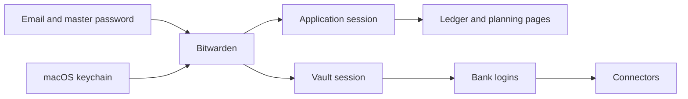
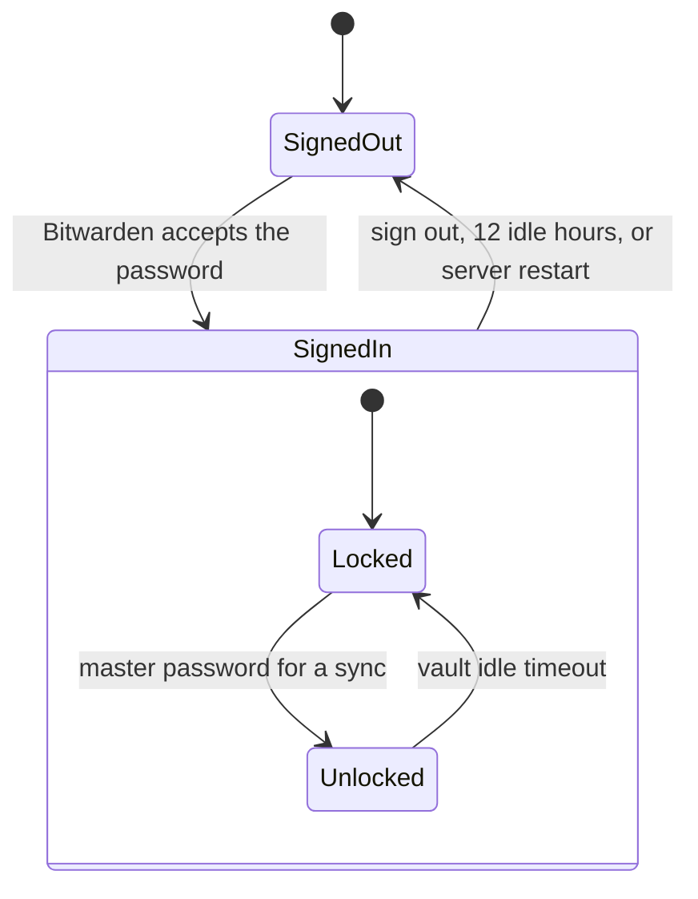

# Access and vault

## Purpose

Two permissions are separate: permission to use omsync, and permission to read bank logins from
the vault. You can read reports without an unlocked vault.

## Context

## Flow

Sign-out also locks the vault.

## Design decisions

- **Bitwarden is the only password.** omsync has no master password of its own.
- **The vault locks on its own timer.** A locked vault does not end your session. Locked is the
  normal state, so the status dot is gray, not red.
- **Secrets never touch disk or logs.** The master password and the vault session stay in memory.
  A secret goes only to the Bitwarden process that needs it.
- **API keys live in the keychain.** The settings file and the database never hold them.
- **One error for a wrong email or password.** The error does not tell which was wrong.
- **Local HTTP is correct here.** A secure-cookie rule would block sign-in on `127.0.0.1`.
  SameSite cookies and origin checks protect requests instead.
- **The demo has no vault.** Demo sign-in reads no password. Bank sync is off.

## Terms

- **Vault:** your Bitwarden account. It checks sign-in and holds bank logins.
- **Application session:** in memory. It ends after 12 idle hours or a server restart.
- **Vault session:** in memory, with its own idle timeout.
