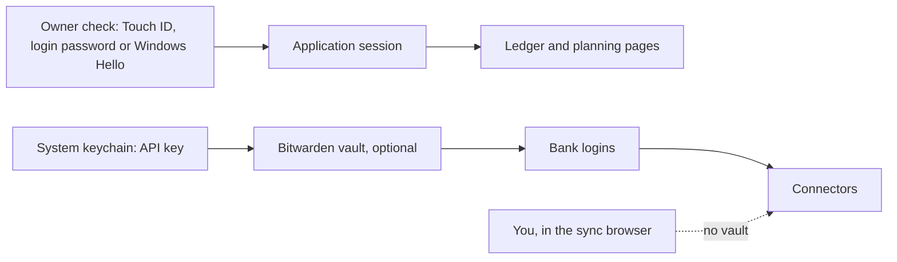
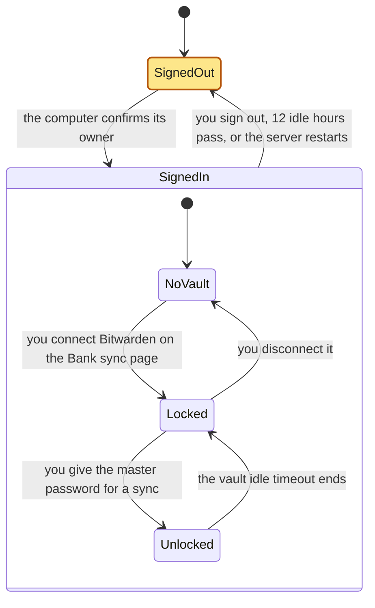

# Access and vault

## Purpose

Two permissions are separate: permission to use omsync, and permission to read bank logins from
the vault. The computer gives the first. The vault is optional and gives the second.

## Context

## Flow

Sign-out also locks the vault.

## Design decisions

- **omsync has no password of its own.** A password that you can reset protects nothing more than
  the computer account does. omsync gets only a yes or a no from the owner check.
- **The threat is other websites and other computer accounts.** A person at your unlocked computer
  is an accepted risk.
- **The owner check is tested on macOS.** Windows Hello is not tested. Other systems cannot sign
  in.
- **A new install has no vault.** You sign in at each bank yourself, then select **I have signed
  in**. Any password manager can fill that page.
- **A connect unlocks the vault before it saves.** A wrong email or master password is never
  saved.
- **Secrets stay in memory.** This includes the master password and the vault session. The API key
  is in the system keychain. Logs contain stack frames and error types, not error messages.
- **Cookies are SameSite and checked by origin.** They are not Secure, because Secure cookies need
  HTTPS and the server uses HTTP.
- **The vault locks on its own timer.** A locked vault does not sign you out.

## Terms

- **Owner check:** the computer's own prompt for its account owner.
- **Vault:** the password manager that holds bank logins. Bitwarden is the only one.
- **Application session:** in memory. It ends after idle time or a server restart.
- **Vault session:** in memory, with its own idle timeout.
