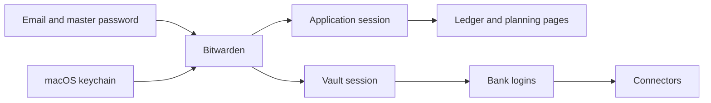
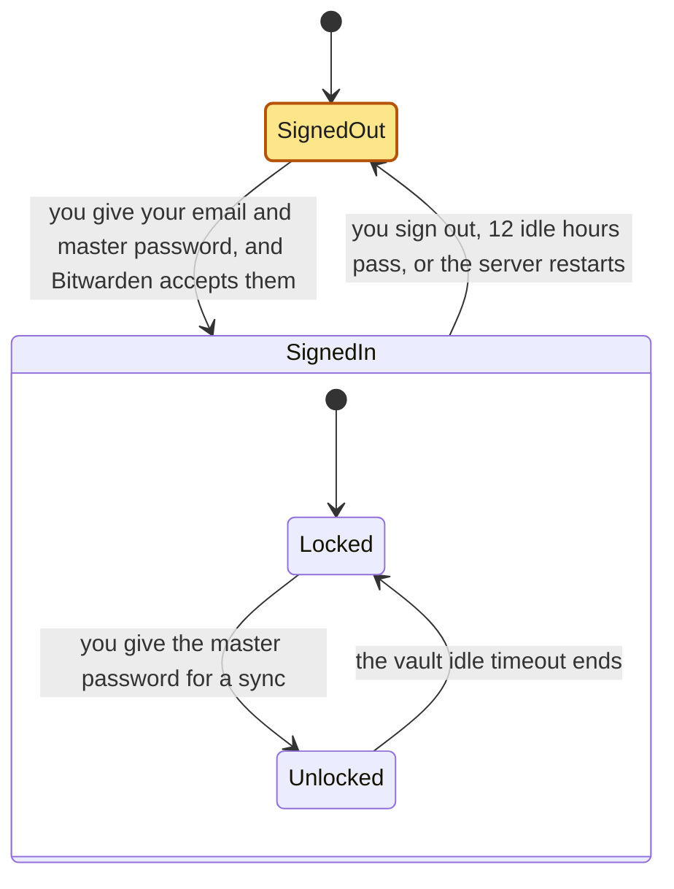

# Access and vault

## Purpose

Two permissions are separate: permission to use omsync, and permission to read bank logins from
the vault. You can read reports without an unlocked vault.

## Context

## Flow

Sign-out also locks the vault.

## Design decisions

- **Bitwarden holds the only password.**
- **Secrets stay in memory.** This includes the master password and the vault session. API keys are
  in the macOS keychain. Logs contain stack frames and error types, not error messages.
- **Cookies are SameSite and checked by origin.** They are not Secure, because Secure cookies need
  HTTPS and the server uses HTTP.
- **The vault locks on its own timer.** A locked vault does not sign you out.

## Terms

- **Vault:** your Bitwarden account. It checks sign-in and holds bank logins.
- **Application session:** in memory. It ends after idle time or a server restart.
- **Vault session:** in memory, with its own idle timeout.
