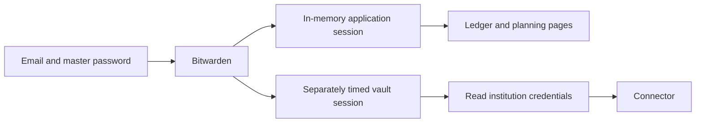

# Access and vault

## Purpose and design philosophy

omsync has two different permissions: permission to use the application and permission to
read credentials from the vault. Reading reports should not require keeping institution
credentials unlocked all day.

The **vault** is the user's Bitwarden account. It verifies sign-in and supplies the
institution logins used by connectors. omsync does not maintain a second master password.

## Behavior

- Sign-in asks for the vault email and the master password, whose field is labeled
  "Password" under a "with your Bitwarden account" subtitle. Bitwarden verifies them; a successful
  sign-in creates an application session.
- The application session lives in memory and expires after twelve idle hours. Activity
  extends it; restarting the server ends it.
- The vault has its own configurable idle timeout. Locking it does not end the application
  session. An operation that needs credentials asks to unlock it when necessary.
- Sign-out ends the application session and locks the vault.
- Every master password field, at sign-in and when unlocking the vault, has the same
  show/hide control. The field starts hidden, and a reload hides it again.
- Master passwords are never stored, logged, echoed in errors, or included in command-line
  arguments. Vault session keys stay in memory. Secrets passed to the Bitwarden CLI are
  scoped to that child process's environment, never the application's process environment.
- The Bitwarden API client ID and secret live in the macOS keychain. Machine settings and
  the database do not contain them.
- Failed sign-ins have a shared rate limit. Wrong email and wrong password produce the
  same public error; the email can remain in the form, but the password cannot.

## Access boundaries

Product pages require an application session. Sign-in, health, static assets, and synthetic
component/prototype pages are public. Synthetic pages never load the user's ledger.

Sessions use an opaque HttpOnly, SameSite=Strict cookie. Local HTTP is intentional;
a secure-cookie requirement must not make loopback sign-in unusable. State-changing
requests with a foreign Origin are rejected. Requests without an Origin remain usable by
local clients. Sign-in return paths must be local paths, never redirects to another site.
Authenticated pages use no-store caching so history navigation cannot reopen a cached
financial page after sign-out.

## Design rationale

Loopback binding does not prevent a malicious website from attempting browser requests to
the application. Authentication, origin checks, and cookie restrictions therefore remain
necessary even for a single user.

Separate session lifetimes reduce credential exposure without interrupting ordinary
ledger work. Child-process secret scoping prevents an unrelated subprocess from inheriting
an unlocked vault session. Safe errors describe what the user can do without reproducing
credential values or uncontrolled CLI output.

The sign-in presentation draws inspiration from Sure; the access model is built around
omsync's local operation and the user's existing vault.
