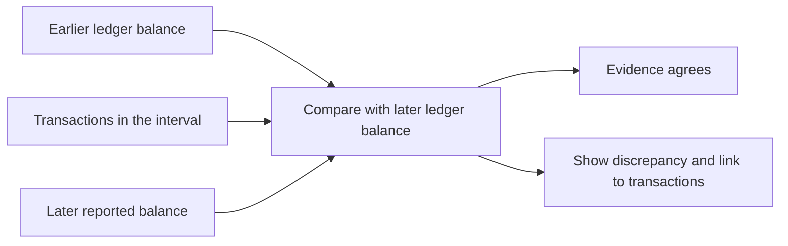

# Accounts

## Purpose and design philosophy

Accounts connect source identity, transaction history, and the institution's reported
balances. Their pages make trust in imported history visible rather than displaying a
balance without showing where it came from. Sure's account presentation inspires the
panel and balance-history view.

## Behavior

The accounts panel lists open accounts grouped by type, with name, masked last four digits,
joint status, latest ledger balance, and recent balance trend. Group subtotals sum known
balances; absent evidence appears as absent, not as an invented zero balance. A viewer option
groups them by institution instead, one group per institution named by its display name, with
no subtotals because netting a card's debt against a checking balance is meaningless. Each
institution group shows the institution's logo beside its name (see
[Settings](settings.md#bank-sync)). The choice is a database presentation preference.

An account page shows institution, type, joint and closed status, balance and its date,
transaction count and range, balance history, balance-check results, recent institution
sync attempts, and the account's nicknames, which it also edits (see
[contacts](contacts.md#account-nicknames)). It links to the register scoped to that account. Closed accounts leave the
normal panel without losing their history.

Account edits change name, joint status, closed status, or the displayed last four digits
through [batches](changes.md). The account page edits all four. Bank sync also renames an account from its row, as the same
batch. Changing a display name or closing an account does not change its identity or remove its
transactions. Names need not be unique, so screens that show a name add the masked last four
digits. Statement-account mapping follows the [ledger identity contract](ledger.md).

A reissued card is the same account, not a closed one and a new one. Mapping the new statement
ID as an alias keeps the history together and tells a bank connector which number to look for;
it leaves the displayed last four unchanged, so the person changes that label on the account
page when they choose. Until a file names the new card, its alias can be only its last four
digits: the connector looks for the account by them, and the first file sync fetches for them is
linked to the account. Wherever an account's digits appear, the last four of its newest alias
follow when they differ from the label, as `••1234 · alias ••5678`, so a screen never hides
which number the bank now knows the account by.

## Balance agreement

Only reported ledger balances determine the displayed balance; an available balance is not
substituted. Credit-card balances retain the source's sign. With several imported balances
on the latest date, the most recently imported one is displayed, while contradictory
same-day evidence remains visible to the check.

For consecutive balance dates, the earlier balance plus transactions after that date and
through the later date must equal the later balance. The beginning date is exclusive and
the ending date inclusive. Different balances reported for the same date are also an issue.
A check displays expected balance, computed balance, difference, and the interval's
transactions. It reads only.

## Design rationale

A discrepancy can indicate missing or duplicate activity or conflicting source evidence.
It must not be “fixed” by generating an adjustment, overwriting a balance, or altering a
transaction amount. Review the source and transaction history instead.

Balance agreement and reconciliation are independent. Transfers may be fully linked while
an account is missing a statement; conversely, balances can agree while reimbursements
remain unexplained. Showing both source balance evidence and ledger activity makes those
different questions understandable.

Joint share changes reporting totals, not the account balance. An account page always
shows what the institution reported for the account, not a calculated personal half.
