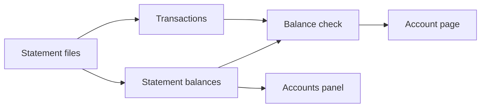
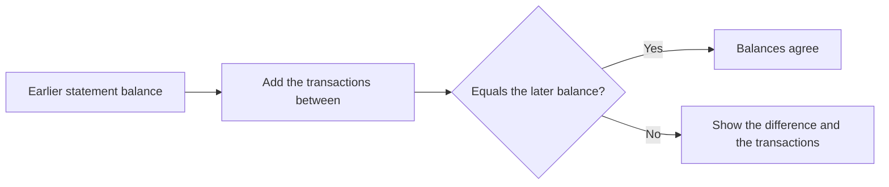
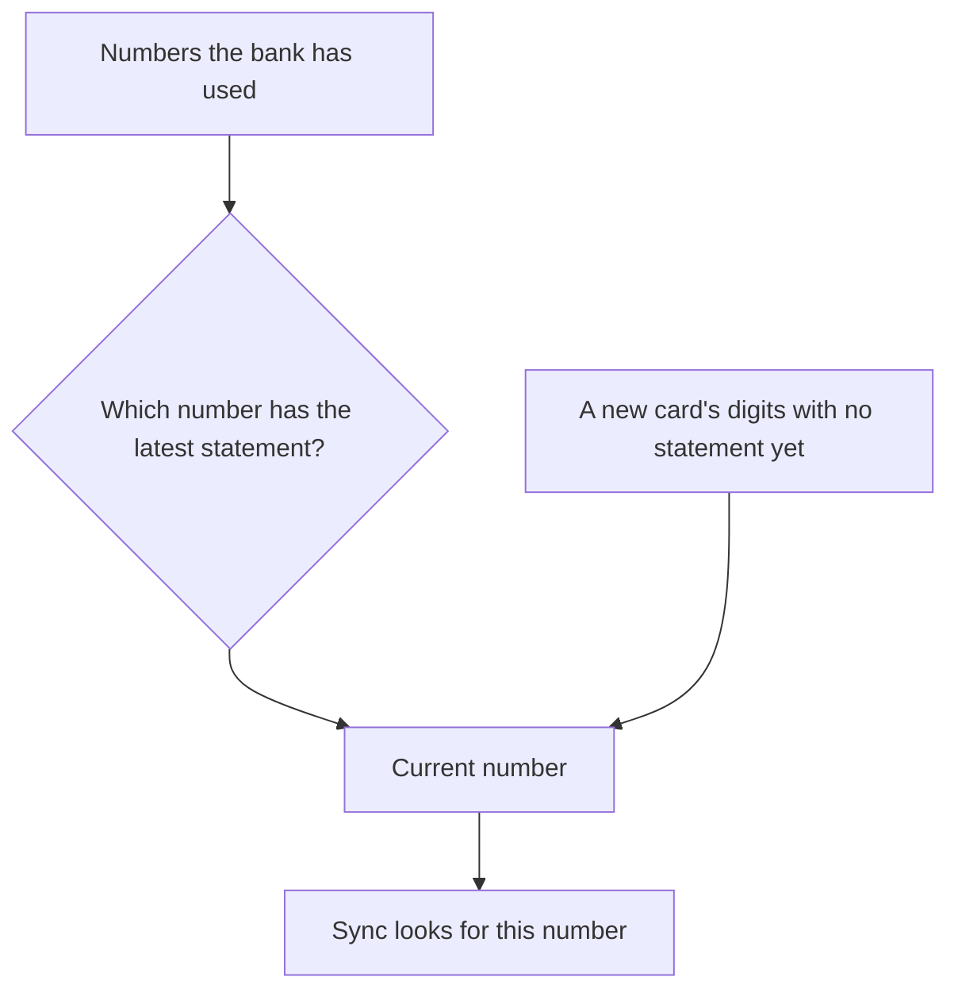

# Accounts

## Purpose

An account page shows the balance the bank reported, and whether the statements agree with the
transactions. You can see where each number comes from.

## Context

## Flow

### Balance check

### Current card number

## Design decisions

- **Show the reported balance only.** omsync never substitutes the available balance or a
  calculated half.
- **Never fix a difference.** omsync never adds an adjustment or edits an amount. A difference
  means a missing or duplicate transaction. You look at the source.
- **Balance agreement is not reconciliation.** Linked transfers do not prove a statement history
  is complete. Agreed balances do not prove reimbursements are explained.
- **A reissued card is the same account.** Its new number is an alias. The history stays together.
- **Derive the current number from statements.** omsync does not store it. The order that you
  added numbers in does not matter.
- **Closed accounts keep their history.** They move to a Closed group at the bottom of the panel.
- **Institution groups have no subtotal.** A card's debt and a checking balance do not add up to a
  useful number.

## Terms

- **Alias:** a statement account number that maps to an account.
- **Current number:** the number the bank uses now, from the latest statement.
- **Nickname:** the name a payment app shows for an account. See [contacts](contacts.md).
