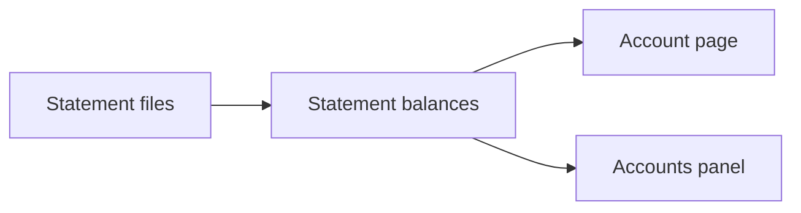
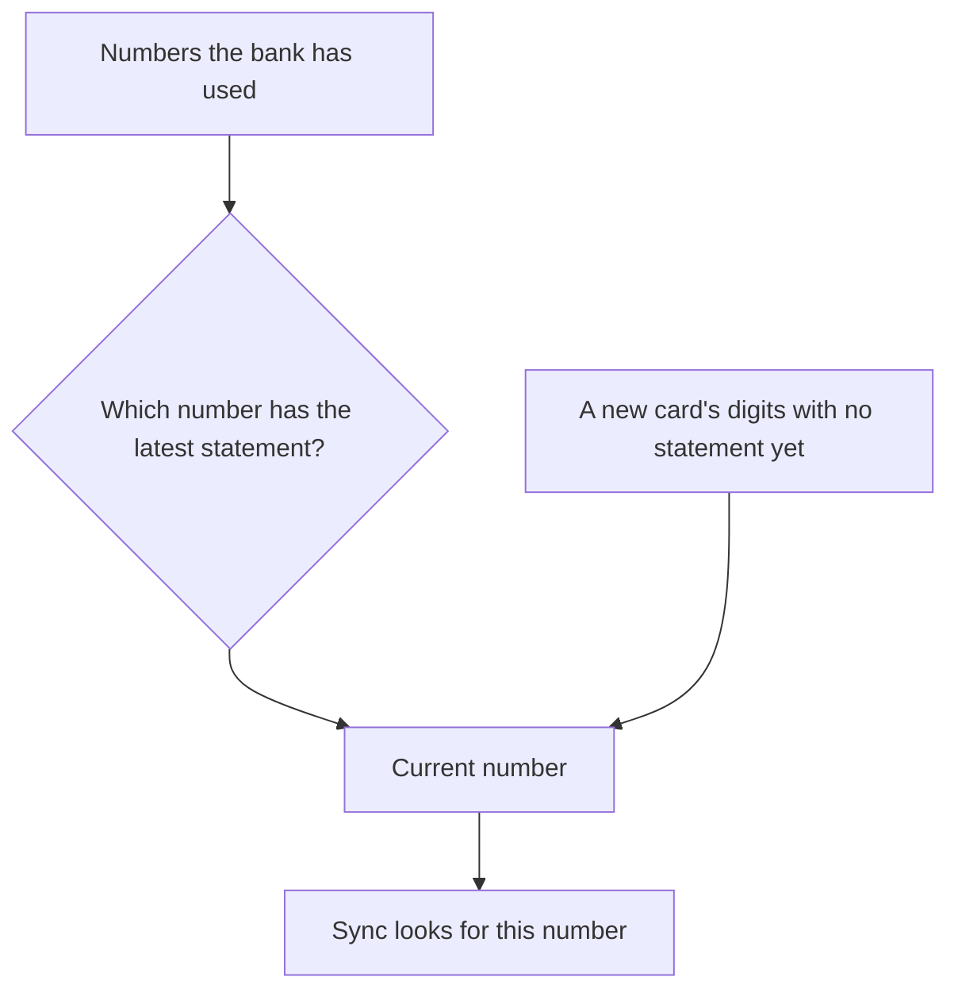

# Accounts

## Purpose

An account page shows the balance the bank reported. You can see where each number comes from.

## Context

## Flow

### Current card number

## Design decisions

- **The account shows the balance that the bank reported, as it is.** It shows no available
  balance and no joint half.
- **The balance stands alone.** It is the amount at download time. A bank can post a transaction
  later with an earlier date, so a sum of transactions by date can differ from it. A check of the
  two gave only false warnings, so omsync makes none.
- **The current card number comes from the statements.** It is the number on the latest statement.
  omsync does not store it.

## Terms

- **Alias:** a statement account number that maps to an account.
- **Current number:** the number the bank uses now, from the latest statement.
