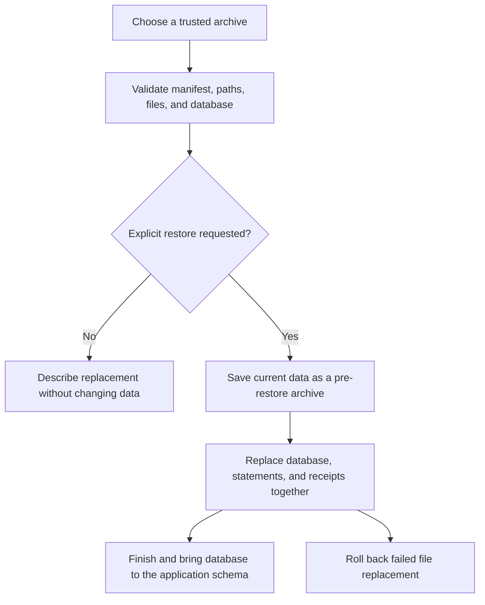

# Backups and recovery

## Purpose and design philosophy

Recovery must restore both financial interpretation and its source evidence. A database
alone is not a complete backup when statement and receipt files are needed to explain it.
The user must be able to verify an archive before replacing current data.

## Behavior

A full backup is a `.tar.gz` archive containing the database, statements, receipts, and
machine configuration when a config file is in use. A manifest records file sizes and
SHA-256 checksums, the database revision, and the application version. SQLite's backup API
produces a coherent database copy rather than copying a potentially active database file.

Vault state, keychain entries, browser sessions, exports, previous archives, and lock files
are not archived. Credentials remain under their original security boundaries; generated
reports can be produced again. Restoring onto another machine requires setting up credentials
and browser sign-ins separately.

Archives are plaintext financial data compressed into one file. omsync does not encrypt or
authenticate them. Checksums detect damage, not who made an archive. The user keeps archives
on protected storage and restores only trusted archives. Full archives are retained until
the user deletes them.

## Restore flow

Without explicit confirmation, restore checks the archive and describes what it would
replace. Invalid checksums, unsafe paths, unexpected archive content, or an unrecognized
database revision are refused before replacement. Restoring is whole-state replacement,
not a merge of individual transactions or a selective file recovery.

Before replacement, existing data is saved in a pre-restore archive. A failed replacement
puts the previous database and source folders back. A process interruption can leave
moved-aside data in a restore work directory; the pre-restore archive is the independent
recovery source. A later schema-upgrade failure must be reported, not described as a
successful restore.

An existing machine config is kept. Archived config is written only when no config exists,
so restore cannot silently redirect an established installation's data directory. The
archived database is checked before replacement and then migrated as needed for use.

## Operation boundaries

Sync, Costco download, archive creation, and restore share an exclusive operation lock.
Restore also requires the server lock: it cannot replace the database underneath a running
application. Locks are held for the operation and released on completion or failure.

Database-only copies serve a different purpose. Starting the server or explicitly upgrading
the schema first copies an existing database as an automatic safety backup, retaining the
newest ten. A manual database copy is retained until removed. Neither is a full source-file
archive, and the archive restore command does not read database-copy files.

A database snapshot copies the database into a separate, new data directory and migrates
only the copy. It exists for inspection and experiments: the configured database is read
but never written or migrated, and nothing treats the snapshot as a backup.

## Design rationale

Keeping statements and receipts beside the database preserves reproducible evidence.
Excluding browser and vault sessions avoids transporting unlocked access as part of
financial recovery. Retaining the existing machine config prevents an archive's old paths
from deciding where a new installation should operate.

The pre-restore archive protects activity added since the selected backup. Verification
must precede both the safety archive and replacement, so damaged input causes no financial
mutation. Recovery is separate from ordinary [batch undo](changes.md): it replaces the
whole local dataset, not one domain decision.

See [back up and restore](../how-to/back-up-and-restore.md) for the operating procedure.
