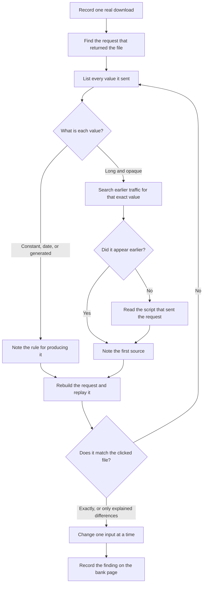
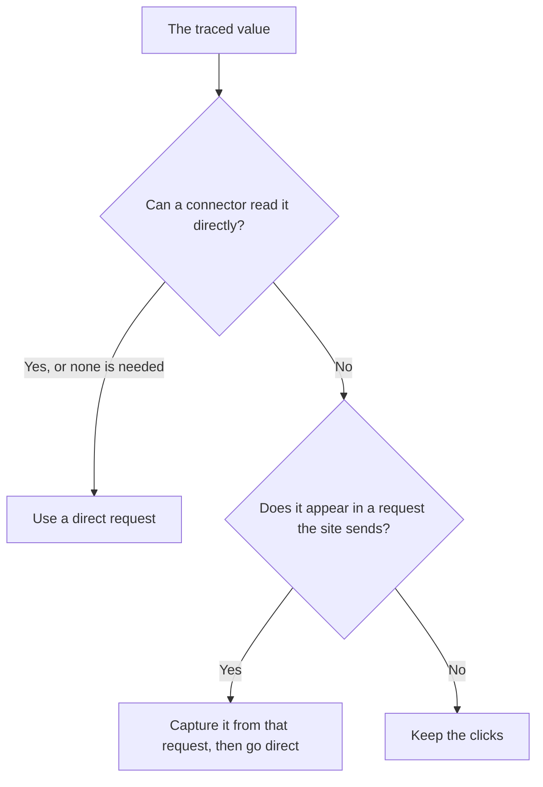

# Reconstructing bank requests

## Purpose

A connector can get a statement by clicking through a bank's website, or by sending the request
those clicks would send. A direct request skips dialogs, waits, and selectors that break when a
page changes. This page explains how to work out what that request needs, and how to prove it
works. The bank pages record what the process found:

- [Bank of America](boa.md)
- [Fidelity Rewards](fidelity.md)
- [Chase personal and Chase Business](chase.md)
- [Citi](citi.md)

The question is not "where is the CSRF token?" It is "what does the server need for this request
to work?" Three of the four banks traced here need no CSRF token at all.

## Status

The requests were traced live on 2026-11-05, Citi's on 2026-11-07, and the connectors send them.
Each connector has since synced successfully against its bank, using the sign-in watch in
[sync](../sync.md#signing-in). A change to a connector needs another live sync, because
[fixtures cannot show what a website accepts](../sync.md#browser-and-safety-rationale). Each bank
page lists what is still unproven.

| Bank | Token the download needs | Where it comes from |
|---|---|---|
| [Bank of America](boa.md) | None, only an account key | The account overview |
| [Fidelity Rewards](fidelity.md) | Bearer token | Browser session storage |
| [Chase](chase.md) | `csrftoken` | A dedicated token endpoint |
| [Citi](citi.md) | None, only its `client_id` cookie as a header | The session's cookies |

## Tools

`scripts/bank_record.py` opens Chrome on a temporary profile and records a download.
`scripts/bank_trace.py` reads the capture: with no pattern it lists the likely download requests,
and with one it sorts each value of the matching requests and names where it first appeared. Both
files describe their use. Neither prints token values, and a capture cannot be saved inside this
repository or the data folder.

## The process

### 1. Record a real download

The person signs in and downloads a statement while a recorder logs the browser's traffic. Doing
it for real shows the current request, which reading old code or guessing cannot.

Record each kind of account separately, because they often use different requests. Choose a date
range that holds transactions, and keep the clicked file: it is the answer the replay is checked
against.

`bank_record.py` logs requests, responses, and response bodies from every page, frame, and
worker, and snapshots cookies and browser storage when it stops. Network logs alone are not enough, since a value may
live only in storage or in a response body.

### 2. Find the request that returned the file

Look for the response whose content is the statement. A `blob:` download URL means a script
already fetched the file, so the real request is an earlier `fetch` or XHR, not the link.

### 3. Sort every value

List each query field, form field, and non-standard header, then sort them:

| Kind | How to recognize it | What to do |
|---|---|---|
| Constant | The same short word or code every time | Send it as is |
| Input | A date, file type, or account choice | Build it from the sync's request |
| Generated | A 36-character UUID that never appeared before | Generate a new one |
| Decoy | Looks important, but holds a placeholder | Send it as is |
| Session or account value | Long and opaque | Trace it |

### 4. Trace values by value, not by name

Search everything recorded before the download for the exact value, including its URL-encoded
form. The same value can have different names in different places, while a matching name can be
unrelated. The earliest hit is the source.

Check all of these: response bodies, `Set-Cookie` headers, earlier request URLs and bodies,
cookies, `localStorage`, and `sessionStorage`. Skip values of a few characters, which match
almost everything.

If a value appears nowhere, a script created it. The request's initiator names the script that
sent it. Search that script for a constant the request carries, then read how it builds the
request. The same search works when a request body is unavailable.

### 5. Replay the request and compare

Send the rebuilt request from a signed-in tab, using `fetch`, so the bank's cookies apply. A
success status proves little, because a bank can answer an error with a `200`. Compare the raw
bytes with the clicked file, and explain every difference: a server timestamp is harmless, a
missing row may not be.

Read both files as bytes. Text mode can change line endings and report a false difference.

### 6. Change one input at a time

A replay of the same request only shows that the copy works. Then test what the connector needs:

- Use a different date range, and check that the rows stay inside it.
- Remove a field that looks unnecessary, to learn whether it is required.

Only count a test that could have failed. A range holding the same rows as the default looks the
same whether or not the filter works, so choose a range that must return fewer rows.

### 7. Decide the outcome

## Safety rules

- Record in a temporary browser profile. `~/omsync-data` and its browser profile stay untouched.
  A temporary profile is a new device to the bank, so expect to complete MFA.
- The person signs in themselves. A CAPTCHA or verification step is theirs to complete, and is
  [never bypassed](../sync.md#behavior).
- Do not save request bodies from sign-in and MFA pages, or fields named like a password or code.
  Match on field names: a random token can contain letters such as `otp` by chance.
- Analysis prints names, lengths, and locations. It does not print token values or transactions.
- Keep replays few and read-only, because repeated failures can trigger a bank's fraud checks.
- Delete the capture when finished. It holds live session cookies and statements, so it never
  enters this repository. Findings here hold field names and rules, never account values.

## Common mistakes

- **Trusting a name.** Bank of America has a `getCSRFToken` endpoint that its downloads do not
  use, and Chase's `x-jpmc-csrf-token` header holds the word `NONE`.
- **Searching only HTML and cookies.** Chase's token is in a JSON response.
- **Stopping at one account type.** A checking and a card download can differ in method, host,
  and fields.
- **Assuming the tool is right.** Before concluding the site changed, check that the capture
  finished and that the comparison reads files correctly.
