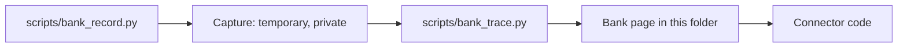
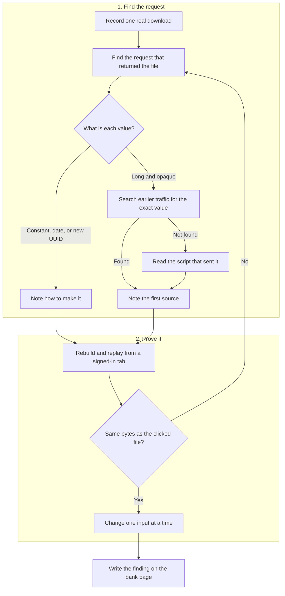

# Reconstructing bank requests

## Purpose

A connector sends the request that the bank's download button sends. A direct request survives a
page redesign. This page shows how to find that request and prove that it works. Each bank page
gives the date of its last live test.

## Context

| Bank | Token the download needs | Where it comes from |
|---|---|---|
| [Bank of America](boa.md) | None, only an account key | The account overview |
| [Chase](chase.md) | `csrftoken` | A token endpoint |
| [Citi](citi.md) | None, only the `client_id` cookie as a header | The session cookies |
| [Fidelity Rewards](fidelity.md) | Bearer token | Browser session storage |

## Flow

## Design decisions

- **Find a value by its content, not its name.** Names can be wrong. Bank of America has a
  `getCSRFToken` endpoint that downloads do not use. Chase's `x-jpmc-csrf-token` header contains
  `NONE`.
- **A success status is not proof.** A bank can send an error with status 200. Compare the bytes.
- **Use only a test that can fail.** A narrow date range must return fewer rows.
- **Keep secrets out of captures.** Use a temporary browser profile. Do not save sign-in or MFA
  bodies. Print names and lengths, not values. Delete the capture after use. Send few replays,
  because repeated failures can start the bank's fraud checks.

## Terms

- **Capture:** a recording of a download's traffic, cookies, and storage.
- **Replay:** the rebuilt request sent from a signed-in tab.
- **Decoy:** a value that looks important but holds a placeholder.
