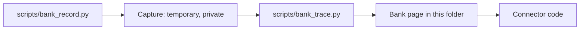
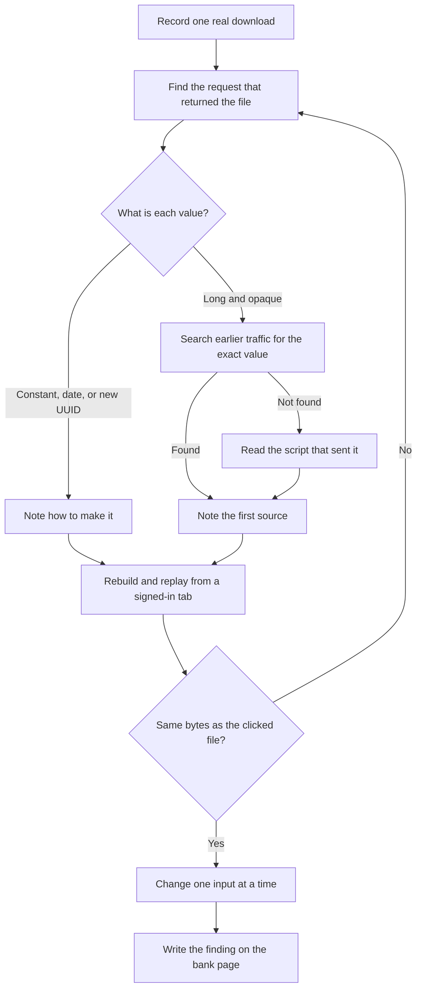

# Reconstructing bank requests

## Purpose

A connector sends the request that a bank's download button sends. A direct request does not
break when a page layout changes. This page shows how to find that request and prove it works.

## Context

| Bank | Token the download needs | Where it comes from |
|---|---|---|
| [Bank of America](boa.md) | None, only an account key | The account overview |
| [Chase](chase.md) | `csrftoken` | A token endpoint |
| [Citi](citi.md) | None, only the `client_id` cookie as a header | The session cookies |
| [Fidelity Rewards](fidelity.md) | Bearer token | Browser session storage |

## Flow

## Design decisions

- **Ask what the server needs, not where the CSRF token is.** Three of the four banks need no
  CSRF token.
- **Trace by value, not by name.** Names lie. Bank of America has a `getCSRFToken` endpoint that
  downloads do not use. Chase's `x-jpmc-csrf-token` header holds the word `NONE`.
- **A success status proves little.** A bank can answer an error with `200`. Compare the bytes.
- **Count only a test that could fail.** A narrow date range must return fewer rows.
- **Record each account type.** Checking and card downloads often differ.
- **Keep secrets out.** Use a temporary browser profile. Do not save sign-in or MFA bodies. Print
  names and lengths, never values. Delete the capture after use.
- **Keep replays few.** Repeated failures can start a bank's fraud checks.

## Terms

- **Capture:** a recording of a download's traffic, cookies, and storage.
- **Replay:** the rebuilt request sent from a signed-in tab.
- **Decoy:** a value that looks important but holds a placeholder.
