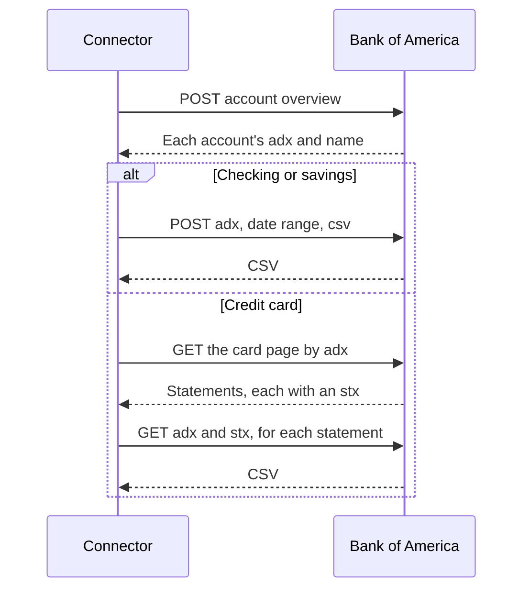

# Bank of America requests

## Purpose

Bank of America downloads need no CSRF token. Each account has one key, `adx`. The session cookies
do the rest. Last validated live: 2026-11-07. Not tested live: a savings account, and more than
one checking account or card.

## Context

The sign-in signal is the account overview request. The connector sends it, not the page.

| State | The overview request |
|---|---|
| Signed in | Answers with the accounts. |
| Signed out | Answers `302` to the public home page. The browser refuses the cross-site redirect, so the request fails. |

## Flow

## Design decisions

- **Cards supply statements, not date ranges.** The connector downloads each statement.
- **The overview masks account numbers.** The last four digits come from the end of the account
  name. An account name without digits cannot match.

## Terms

- **adx:** the key of one account.
- **stx:** the key of one card statement.
