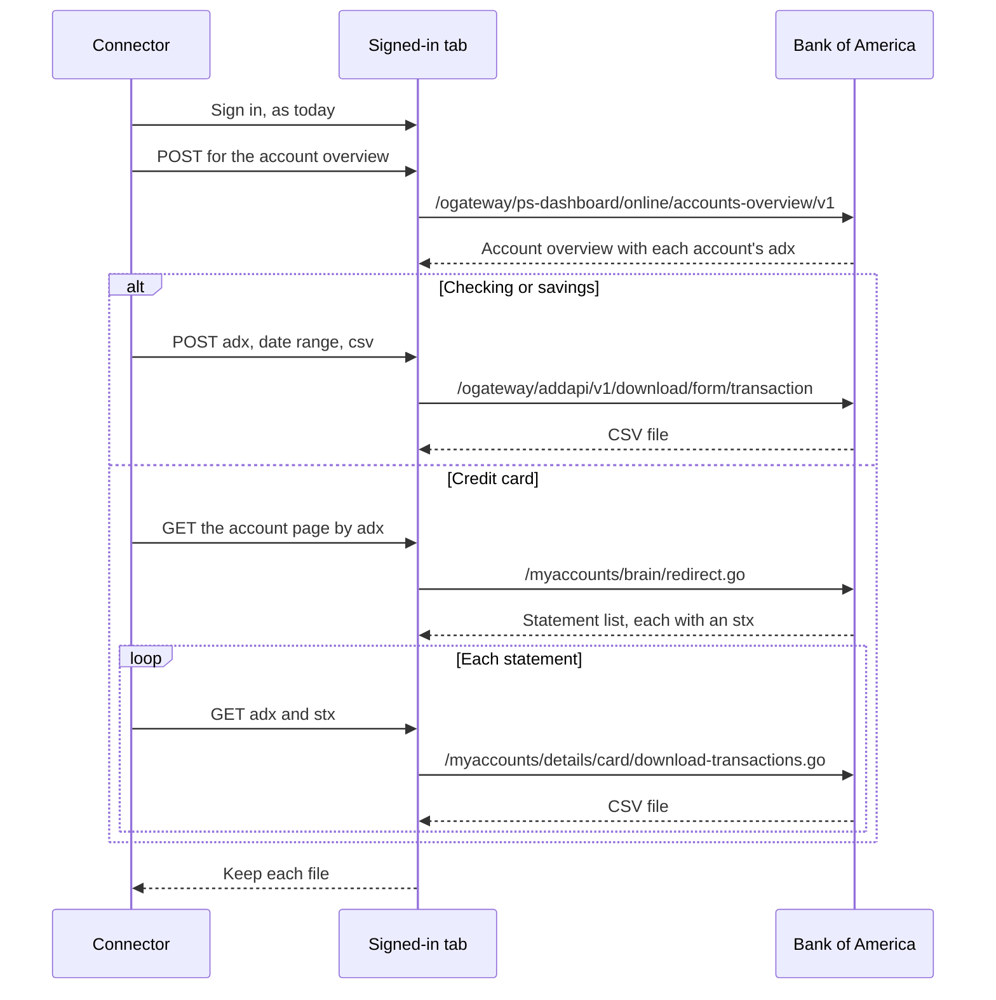
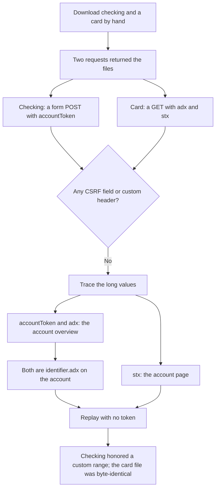

# Bank of America requests

Part of [reconstructing bank requests](README.md). Traced live on 2026-11-05.

## Finding

Bank of America's downloads carry no CSRF token. Each account has one key, `adx`, and the
session's cookies do the rest. Checking and savings use one POST rather than the download dialog.
Cards use two kinds of GET rather than navigating to find their statements.

## Direct flow

## How it was traced

## Steps

### 1. Find the accounts

`POST https://secure.bankofamerica.com/ogateway/ps-dashboard/online/accounts-overview/v1?request_locale=en-us`
with no body, `Content-Type: application/json` and `X-Requested-With: XMLHttpRequest`. This is the
request the accounts page, `/accounts-home/`, sends when it loads, and it needs no token. Accounts
are at `accounts-overview.productCategories[].brandCategories[].customCategories[].accounts[]`.

Until 2026-11-07 the connector reloaded the accounts page and read this answer from Chrome's
network log. That raced: the answer for the page being replaced could be picked, and its contents
were gone after the reload, so a sync sometimes ended with "did not list its accounts". A trace that
day showed the request carries nothing the connector cannot send, so it sends it.

| Field | Meaning |
|---|---|
| `identifier.adx` | The key for every download request |
| `displayName` | Ends in the last four digits, such as `... - 1234` |

The number fields in `identifier`, `accountNumber` and `formattedAccountNumber`, are masked as
`XXXXXX`. An account with no digits in its name cannot be matched.

The account's type in omsync decides between a card and a deposit download.

### 2. Download checking or savings

`POST https://secure.bankofamerica.com/ogateway/addapi/v1/download/form/transaction`, sent as
`application/x-www-form-urlencoded`. The answer is `application/csv`.

| Field | Value |
|---|---|
| `payload.accountToken` | The account's `adx` |
| `payload.locale` | `en-us` |
| `payload.txnSearchCriteria.txnPeriod` | `custom range` |
| `payload.txnSearchCriteria.startDate` | Start date, `MM/DD/YYYY` |
| `payload.txnSearchCriteria.endDate` | End date, `MM/DD/YYYY` |
| `payload.txnSearchCriteria.fileType` | `csv` |

The site's other period, `Current transactions`, sends empty dates.

### 3. Find a card's statements

`GET /myaccounts/brain/redirect.go?target=acctDetails&adx=<adx>` returns the card's page without
navigating to it. Its statement dropdown, `goto_select_trans_top`, has one option per statement,
and each option's link holds that statement's `stx`.

### 4. Download a card statement

`GET /myaccounts/details/card/download-transactions.go` with these query fields:

| Field | Value |
|---|---|
| `adx` | The account's `adx` |
| `stx` | The statement's `stx` |
| `target` | `downloadStmtFromDateList` |
| `formatType` | `csv` |

Cards offer statements, not custom ranges, as [sync](../sync.md#institution-specific-design)
describes.

## Signed-in signal

Read on 2026-11-07 from one recording, by cookie name. Bank of America asked for no code. The last
authentication request, `.../sparta/ls/v2/verifyAuthentication`, set `om_token`, an HttpOnly session
cookie on `secure.bankofamerica.com`, with `ctd`, `UKEY` and `MMID`, which outlive the browser. The
accounts page then set `HeaderDM` and `CoherencePing`, also session cookies. Whether
`verifyAuthentication` comes before or after a code was not seen.

Session storage holds analytics and page state, such as `sparta` and the `celebrus` keys, and no
session value.

Signed out, the account overview request answers `302` to
`https://www.bankofamerica.com/?SMAUTHReason=0…`, the public home page, and the browser refuses to
follow it to another site, so the request fails with a network error. Checked on 2026-11-07 from a
new browser profile.

## Evidence

| Test | Result |
|---|---|
| Checking POST, same transactions as the click | Every transaction row matched |
| Checking POST, 60-day custom range | Rows stayed inside the range, with the same columns |
| Card GET, same statement as the click | Byte-identical |
| Card page by `adx` | Returned the statements, each with an `stx` |
| Account overview sent by the connector (2026-11-07) | A live sync listed the accounts and passed |

The clicked checking file held one more dated row than the replay: the "Beginning balance" line,
which has no amount and is not a transaction.

## Not yet proven

- A sync with a savings account has not been confirmed.
- These results come from one checking account and one card.
- Bank of America loads an anti-bot service on sign-in, so typing without a fixed pause must be
  shown not to disturb it.
