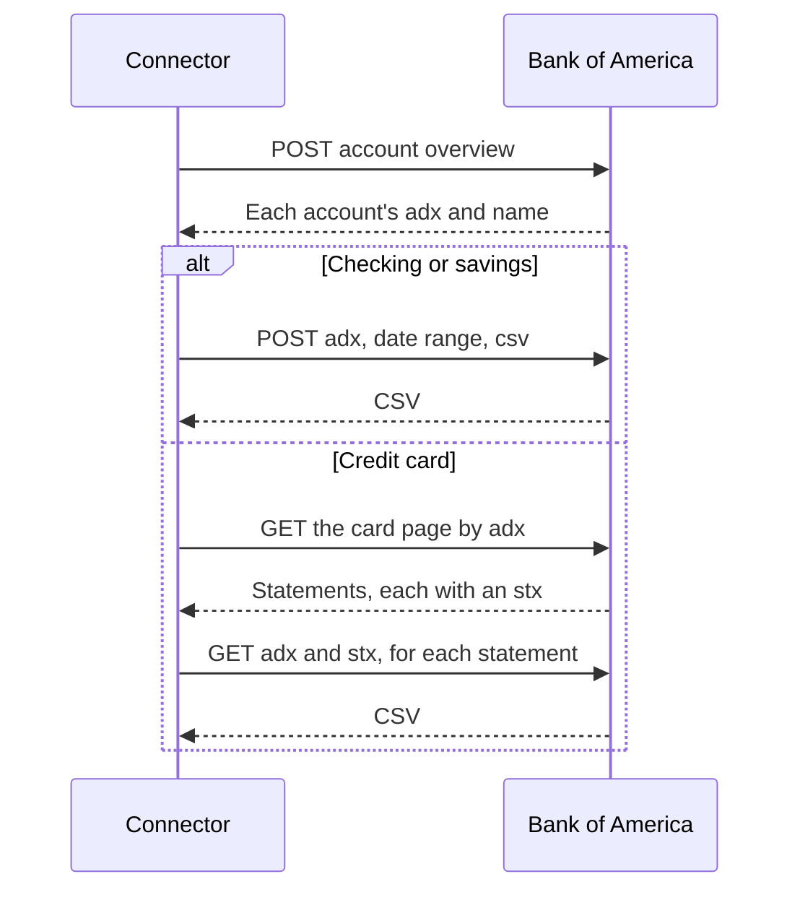

# Bank of America requests

## Purpose

Bank of America downloads need no CSRF token. Each account has one key, `adx`, and the session
cookies do the rest. Traced live on 2026-11-05 and 2026-11-07.

## Sign-in

- **Signed in:** the account overview request answers with the accounts.
- **Signed out:** the same request answers `302` to the public home page. The browser refuses the
  cross-site redirect, so the request fails.
- The connector sends the overview request itself. Before 2026-11-07 it read the page's own
  request from Chrome's log. That raced with page reloads.

## Requests

- **Cards offer statements, not date ranges.** The connector downloads each statement.
- **The overview masks account numbers.** The last four digits come from the end of the account
  name. An account without digits in its name cannot match.

## Tested

| Test | Result |
|---|---|
| Checking, same settings as the click | Same transactions |
| Checking, 60-day range | Rows inside the range |
| Card statement, same as the click | Byte-identical |
| Sync with the connector's own overview request | Passed |

Not yet proven: a savings account; more than one checking account and one card; whether typing
without a pause disturbs the bank's anti-bot check.
