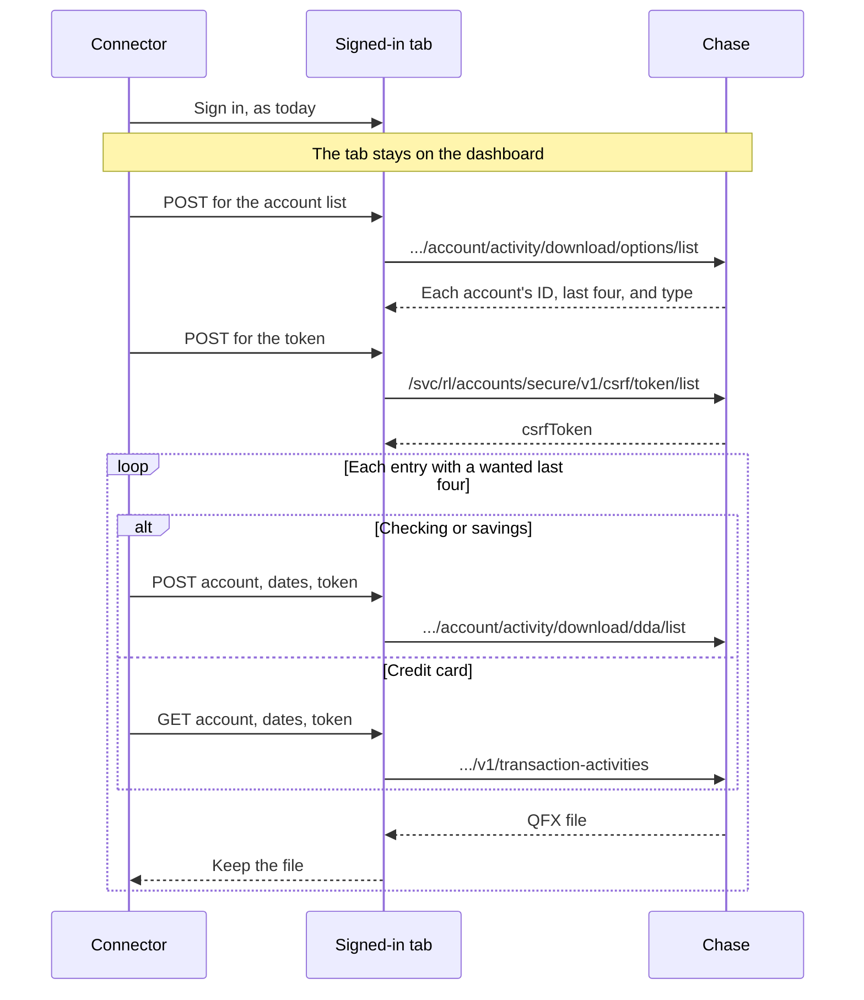
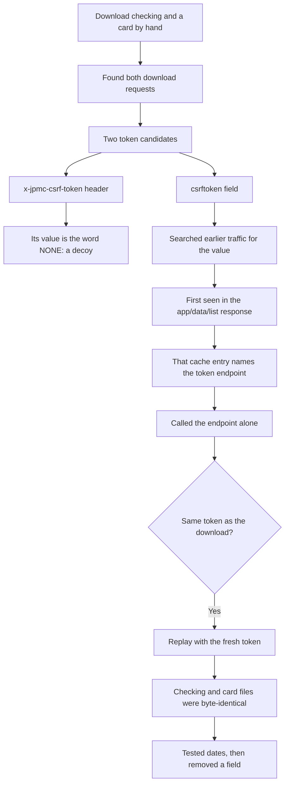

# Chase requests

Part of [reconstructing bank requests](README.md). Traced live on 2026-11-05, on both Chase
personal and Chase Business. Their
[connectors are separate](../../adr/0001-separate-chase-connectors.md) because their sign-in
differs, but the downloads below were the same on both.

## Finding

Chase does use a CSRF token, and a small endpoint returns it in JSON responses, and the site requests it right
after sign-in.

## Direct flow

## How it was traced

## Steps

### 1. Get the token

`POST https://secure.chase.com/svc/rl/accounts/secure/v1/csrf/token/list` with no body. The answer
is JSON with `code` and `csrfToken`, a 64-character value. It was the same on every call within a
session, so request it once per sync, and never keep it after one.

| Header | Value |
|---|---|
| `Accept` | `application/json, text/plain, */*` |
| `Content-Type` | `application/x-www-form-urlencoded; charset=UTF-8` |
| `x-jpmc-csrf-token` | `NONE` |
| `x-jpmc-channel` | `id=C30` |
| `x-jpmc-client-request-id` | A new UUID |

`POST /svc/rl/accounts/l4/v1/app/data/list` also holds the token, in `cache[].response.csrfToken`.
Its position in `cache` differs between personal and Business, so an entry must be matched by its
`url`, never its index. The dedicated endpoint is simpler.

### 2. Find the accounts

`POST https://secure.chase.com/svc/rr/accounts/secure/v1/account/activity/download/options/list`
with no body and the headers from step 1. This is the list behind Chase's download page, and it
answers from the dashboard, so the connector never opens that page. The answer's
`downloadAccountActivityOptions` holds one entry per downloadable account:

| Field | Meaning |
|---|---|
| `accountId` | The ID every download request uses |
| `mask` | The last four digits |
| `summaryType` | `DDA` for checking or savings, `CARD` for a card |
| `detailType` | The finer type, such as `CHK` or `BCC` |

Mortgages and other accounts with no download are left out. The dashboard's `accountTiles` list is
not a substitute: Chase Business did not have one.

Chase Business can list one card twice, with two IDs and the same last four digits. As at every
bank, [each matching entry is fetched](../sync.md#institution-specific-design), and the files are
numbered.

### 3. Download checking or savings

`POST https://secure.chase.com/svc/rr/accounts/secure/v1/account/activity/download/dda/list`, sent
as a form with only the `Accept` and `Content-Type` headers above. The answer is
`application/vnd.intu.qfx`.

| Field | Value |
|---|---|
| `accountId` | The account's ID |
| `dateLo` | Start date, `YYYYMMDD` |
| `dateHi` | End date, `YYYYMMDD` |
| `transactionType` | `ALL` |
| `filterTranType` | `ALL` |
| `statementPeriodId` | `ALL` |
| `downloadType` | `QFX` |
| `csrftoken` | The token |
| `submit` | `Submit` |

The site's preset periods send `dateOption`, such as `LAST_24_MONTHS`. A custom range does not
need it.

### 4. Download a credit card

`GET https://secure.chase.com/svc/rr/accounts/secure/gateway/credit-card/transactions/inquiry-maintenance/digital-transaction-activity/v1/transaction-activities`,
with the `x-jpmc-*` headers from step 1 and `Content-Type: application/json; charset=UTF-8`. The
answer is `application/octet-stream`.

| Field | Value |
|---|---|
| `digital-account-identifier` | The account's ID |
| `start-date` | Start date, `YYYYMMDD` |
| `end-date` | End date, `YYYYMMDD` |
| `account-activity-download-type-code` | `QFX` |
| `csrftoken` | The token |
| `submit` | `Submit` |
| `eligibility-indicator` | `true` |

`eligibility-indicator` goes on both logins, because the site sends it on both.

### 5. Check the answer

A failed request can answer with short JSON, sometimes under a success status. Keep the file only
when it holds `<OFX>`, as the connector does now. Chase's file names are not unique, so omsync's
own file naming stays.

The site first asks for a transaction count (`.../download/count/dda/list` for checking,
`.../v1/transaction-counts` for cards). The replays skipped it and still worked.

## Sign-in check: approve in the app

Traced live on 2026-11-07 on Chase personal, from a new browser profile. Chase no longer offered
a code. The options answer
(`GET /svc/wl/auth/public/gateway/ccb/fraud/authentication/challenge-options/v8/options`) listed
only `INAPP_PULL` and `CALL_US` under `challengeMethodsDisplay.showAll`; `phoneList` and
`emailList` were empty. So "Choose another method" leads only to calling Chase.

Every screen keeps `step=confirmIdentity` in the address, so the connector's current check for
a code request matches all of them. The `caas=` part of the address tells them apart:

| `caas=` | What the page shows | What moves it on |
|---|---|---|
| `options` | `mds-list#optionsList` with one entry, "Sign into our mobile app". No Next button | Choosing the entry |
| `inAppPull` | "Sign in on" and the phone's name in `#inapp-device-name`, `mds-button#next-content` | Next. This sends `POST .../challenge-invocations/v1/invocations` |
| `inAppPullVerify` | `img#qrCodeImage` (a `data:image/png` URL) inside `#qrCodeAccordion`. No buttons but Cancel | Approval in the app |

On `inAppPullVerify` the page polls
`GET .../challenge-statuses/v4/statuses?communication-method-type-code=INAPP_PULL&relay-token-identifier=…`
every `retryWaitSecondCount` seconds (5). The answer's `tokenVerificationStatusCode` stayed
`PENDING` for 96 seconds, until the person scanned and approved. Then it was `SUCCESS`. The page
itself then signed in (`/auth/fcc/login`) and opened `/web/auth/dashboard` with no screen in
between. So the existing signed-in check sees the end, and the connector needs no request of
its own.

The connector follows the screens, not these requests: it chooses on `options`, presses Next on
`inAppPull`, then reads `#qrCodeImage` on `inAppPullVerify` and waits for the dashboard. When the
list offers a code, it takes the code, as before. See
[signing in](../sync.md#signing-in).

Each entry in `optionsList` is a row whose label is only text. Its control is the link after it,
`a.list-item__navigational`, the chevron at the row's right, and only a click there moves on.

### Chase Business: the same screens, with a code

Traced live on 2026-11-07 on Chase Business, from a new browser profile. Business no longer shows
`simplerAuthOptions`. It shows the same `step=confirmIdentity` screens as personal:

| `caas=` | What the page shows | What moves it on |
|---|---|---|
| `options` | Two entries: "Get a text" and "Get a call", each a one-time code. No app entry | Choosing an entry |
| `sms` | The masked phone number, "I already have a code", `#next-content` | Next, which sends the text |
| `verifyOTP` | "Enter your code": `mds-text-input-secure#otpInput`, its input `#otpInput-input` inside it, and `#next-content` | Next, after the code |

The code had 8 digits. After Next the page opened the dashboard, with no password asked again.

Not yet seen: what the status answers when approval is denied or the QR expires, and how long
Chase waits.

## Signed-in signal

Read on 2026-11-07 from the recordings of both logins, by cookie name. Chase sets cookies in two
steps. The password step sets `AMSESSION`, `CAAS`, `sessioncacheid`, `auth-user-info` and others,
while the identity check is still on screen, so they do not mean signed in. Only the login after the
check, the QR approval on personal and the text code on Business, sets `auth-guid` and
`auth_sigguid`. Both are HttpOnly session cookies on `.chase.com`. `adtoken.chase.com` arrives with
them but outlives the browser, so a profile could hold it before sign-in.

Session storage holds only page state, such as `IS_OVD_LOADED`, and no session value.

The account list request (step 2) answers only once sign-in is complete. Sent from the page at
each moment on 2026-11-07, from a new browser profile on Chase personal:

| Moment | Answer |
|---|---|
| Signed out | `401`, `{"status":401,"code":"APPID:UnauthenticationException"}` |
| Password accepted, choice screen (`caas=options`) | The same `401` |
| Password accepted, QR pending (`caas=inAppPullVerify`) | The same `401` |
| Approved in the app, dashboard | `200`, `code: SUCCESS`, the accounts |

While the check is pending, the page itself calls only the public `challenge-*` endpoints.

## Evidence

| Test | Personal | Business |
|---|---|---|
| Token endpoint alone | Same token as the download | Same token as the download |
| Checking, same settings as the click | Byte-identical | Byte-identical |
| Checking, 60-day range | Rows inside the range | Rows inside the range |
| Card, same settings as the click | Byte-identical | Byte-identical |
| Card, narrow range | Not proven | Fewer rows, all inside the range |
| Card without `eligibility-indicator` | Not tested | `500` error |
| Account list called from the dashboard | Not tested | Matched the download page's accounts |
| Download page entries found in the dashboard's data | All four matched `accountTiles` | No tiles present |

## Not yet proven

- The site sends `eligibility-indicator` on personal cards, but only Business was tested without
  it. Sending it on both matches the site either way.
- Whether a card's two Business entries hold the same transactions was not compared. A sync keeps
  both files. `controlCard` on each entry may explain the pair, and its values were not read.
- A range with no transactions was not tested. It should answer with an error or an empty file,
  which a sync reports as a skipped account.
