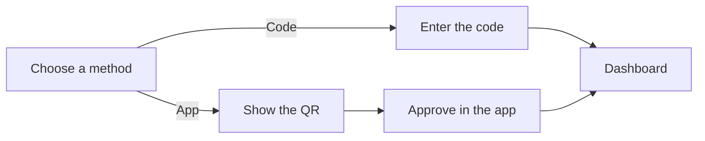
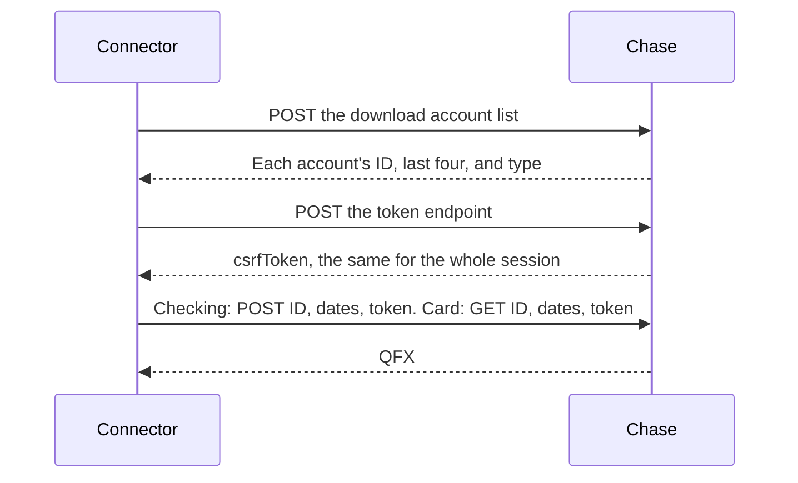

# Chase requests

## Purpose

Chase downloads need a CSRF token from a token endpoint. Personal and Business use the same
downloads but different sign-in steps, so they have separate connectors. Traced live on 2026-11-05
and 2026-11-07.

## Sign-in

- **Signed in:** the account list answers `200`. Before that, it answers `401`, also while an
  identity check is on screen.
- **Personal identity check:** Chase offers a code or an approval in the Chase app. For the app,
  the page shows a QR. You scan it and approve on the phone. The page then signs in by itself.
- **Business identity check:** the same screens, with a text or call code of 8 digits.
- **Cookies are not a signal.** The password step sets session cookies while the check is still on
  screen.

## Requests

- **`x-jpmc-csrf-token: NONE` is a decoy.** The real token is the `csrftoken` field.
- **A card request needs `eligibility-indicator=true`.** Without it, Business answers `500`.
  omsync sends it on both logins, as the site does.
- **Business can list one card twice** with two IDs. omsync fetches both. Import joins the
  repeated rows.
- **An error can come with `200`.** omsync keeps a file only when it holds `<OFX>`.
- **The connector stays on the dashboard.** It never opens the download page.

## Tested

| Test | Personal | Business |
|---|---|---|
| Token endpoint alone | Same token as the download | Same |
| Checking, same settings as the click | Byte-identical | Byte-identical |
| Checking, 60-day range | Rows inside the range | Rows inside the range |
| Card, same settings as the click | Byte-identical | Byte-identical |
| Card without `eligibility-indicator` | Not tested | `500` |
| Account list from the dashboard | Not tested | Matched the download page |

Not yet proven: whether Business's two entries for one card hold the same rows; the answer for a
range with no transactions; what the app approval returns when it is declined or expires.
