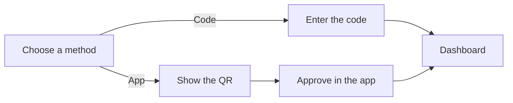
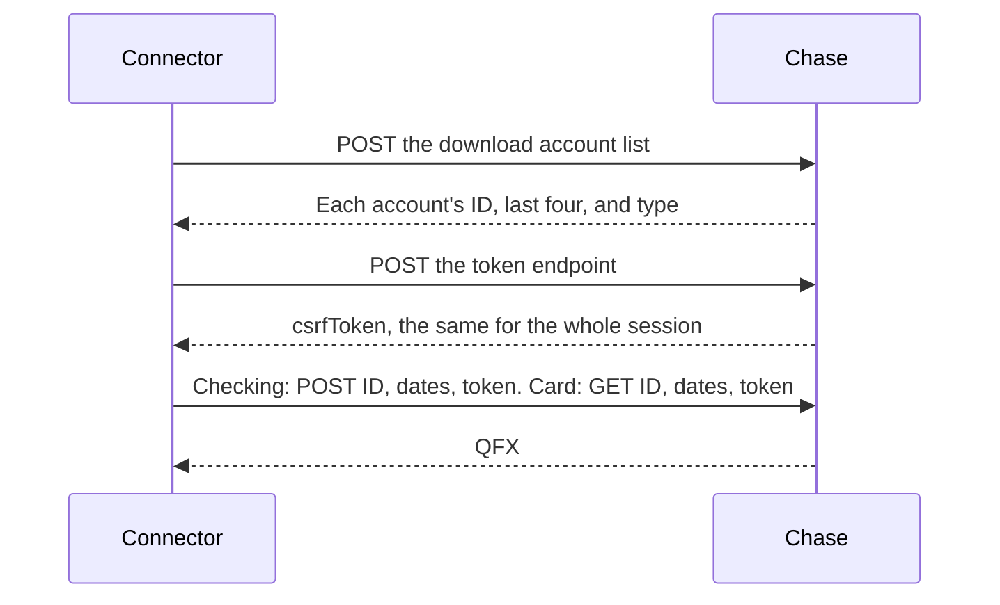

# Chase requests

## Purpose

Chase downloads need a CSRF token from a token endpoint. Personal and Business use the same
downloads and separate logins, so each has its own connector. Last validated live: 2026-11-07,
and the Business sign-in with a text code on 2026-11-13. Not tested live: a declined or expired
app approval.

## Context

The sign-in signal is the account list. It answers `401` before sign-in, also while an identity
check is on screen. It answers `200` after sign-in. Cookies are not a signal: the password step
sets session cookies while the check is still on screen.

- **Personal:** Chase offers a code or an approval in the Chase app. For the app, the page shows a
  QR. You scan it and approve on your phone. The page then signs in by itself.
- **Business:** the same screens. The code has 8 digits and arrives by text or call.

## Flow

## Design decisions

- **The `x-jpmc-csrf-token` header is not the token.** Its value is `NONE`. The real token is the
  `csrftoken` field.
- **A card request must send `eligibility-indicator=true`.** Without it, Business returns status
  500. omsync sends it for both logins, as the site does.
- **Business can list one card two times, with two IDs.** omsync downloads both. Import joins the
  repeated rows.

## Terms

- **CSRF token:** a value that the download request must carry. Chase issues it per session.
