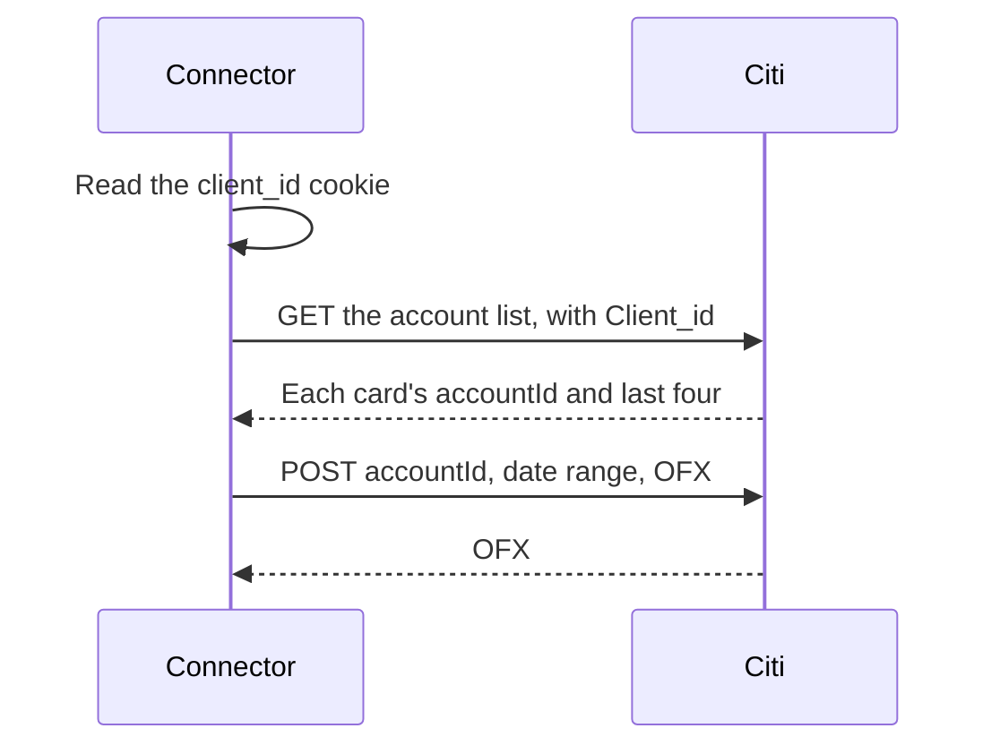

# Citi requests

## Purpose

Citi's API needs no CSRF token. Each request repeats the `client_id` cookie as a `Client_id`
header. Traced live on 2026-11-07, on one Costco Anywhere Visa card.

## Sign-in

- **Signed in:** the page's script writes the `client_id` cookie about three seconds after the
  password step. The account list then answers.
- **Signed out:** every page goes to `www.citi.com/login`. The account list request fails because
  the API does not allow another site.
- **`isLoggedIn` means nothing.** It exists before sign-in.
- Citi asked for no code, so its identity check was not seen.

## Requests

- **Three headers are enough:** `Client_id`, `Content-Type`, and `Accept`. The site's extra
  headers change nothing.
- **Citi changes FITIDs between downloads.** Import does not trust them.

## Tested

| Test | Result |
|---|---|
| Account list with only the three headers | `200`, the card and its ID |
| The same with the site's extra headers | Same answer |
| Sync with the connector's own account list | Completed |

Not yet proven: the identity check; an account that is not a card.
