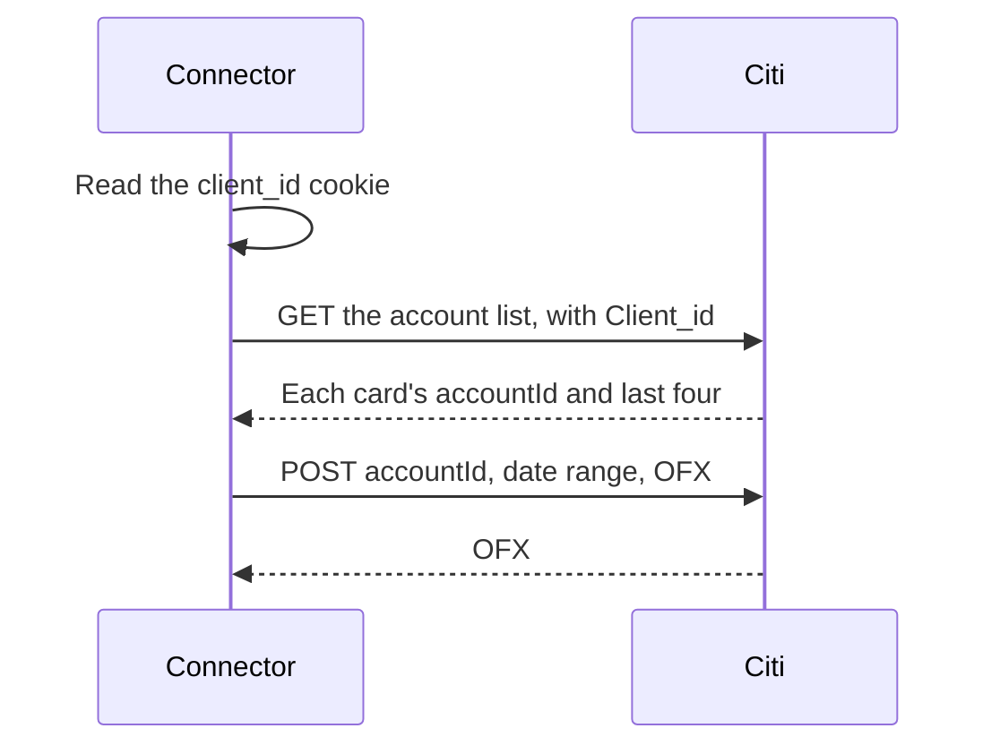

# Citi requests

## Purpose

Citi's API needs no CSRF token. Each request repeats the `client_id` cookie as a `Client_id`
header. Last validated live: 2026-11-07. Not tested live: an identity check, and an account that
is not a card.

## Context

The sign-in signal is the `client_id` cookie.

- **Signed in:** the page's script writes the cookie about three seconds after the password step.
  The account list then answers.
- **Signed out:** every page goes to `www.citi.com/login`. The account list request fails, because
  the API does not allow another site.
- **`isLoggedIn` means nothing.** It exists before sign-in.

Citi asked for no code in the live test, so omsync has not seen its identity check.

## Flow

## Design decisions

- **Three headers are enough:** `Client_id`, `Content-Type`, and `Accept`. The other headers have no
  effect.

## Terms

- **FITID:** the transaction ID in an OFX file.
