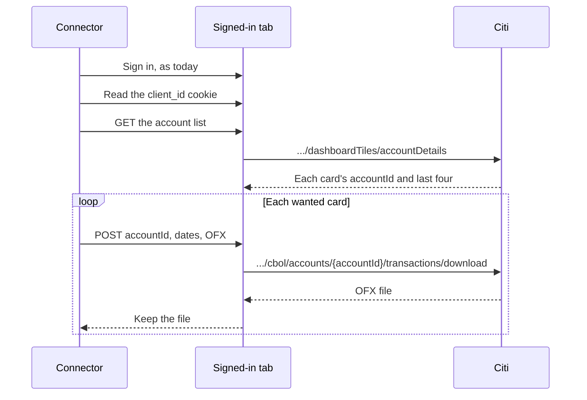

# Citi requests

Part of [reconstructing bank requests](README.md). Traced live on 2026-11-07, on one Costco Anywhere
Visa card.

## Finding

Citi's API needs no CSRF token. Every request repeats the `client_id` cookie as a header, and the
session's cookies do the rest. The account list and the download are both plain API requests, so
the connector reads nothing from the page but that cookie.

## Direct flow



## Steps

### 1. Send the headers

Both requests send these, with the session's cookies:

| Header | Value |
|---|---|
| `Client_id` | The `client_id` cookie |
| `Content-Type` | `application/json` |
| `Accept` | `application/json` |

The site also sends `channelid: CBOL`, `businesscode: GCB`, `countrycode: US`, `appversion`, and
`accept-language: en_US`. The account list answered the same without them.

### 2. Find the accounts

`GET https://online.citi.com/gcgapi/prod/public/v1/v2/digital/customers/dashboardTiles/accountDetails`.
The dashboard sends it when it loads. Cards are at `creditCardAccount.accountDetails[]`:

| Field | Meaning |
|---|---|
| `accountId` | The key the download uses, a UUID |
| `displayAccountNumber` | The last four digits |
| `accountName` | The card's name, such as "Costco Anywhere Visa® Card by Citi" |

Until 2026-11-07 the connector read the account menu's links instead: the ID from each link's
address, and the last four from the end of its text.

### 3. Download

`POST https://online.citi.com/gcgapi/prod/public/v1/cbol/accounts/{accountId}/transactions/download`
with a JSON body. The connector asks for a date range:

```json
{
  "timePeriodFilter": {
    "filterIndicator": "DATE_RANGE",
    "groupFilterIndicator": "CUSTOM",
    "startDate": "MM/DD/YYYY",
    "endDate": "MM/DD/YYYY",
    "displayValue": "Date range"
  },
  "searchKeyword": null,
  "creditCardTransactionType": null,
  "selectedCardId": null,
  "fileFormat": "OFX",
  "moreTransactionsFlag": "false"
}
```

The site's own download, chosen by statement, sent `"filterIndicator": "SINCE_LAST_STMT"` and
`"groupFilterIndicator": "BY_STATEMENT"`, and added `isSearchRequest`, `cardMemberId`,
`transactionAmountStart`, `transactionAmountEnd`, and `multiTransCategoryCode`. The connector's
shorter body predates this trace and has synced live.

## Signed-in signal

Read on 2026-11-07 from the recording, by cookie name. `client_id` is not set by a response. The
page's script writes it about three seconds after `passwordLogin`, on the post-login
`parent-interstitial` page, and the first API request after that carries it. It is a session cookie
on `.citi.com`, and none of the 41 requests to `www.citi.com` before sign-in carried it. Citi asked
for no code, so whether it is written before a code is entered was not seen. `isLoggedIn` exists
before sign-in, so its presence means nothing.

Session storage holds page state, such as `MFA_CURRENT_UI` and `customerType`, and no session
value.

Signed out, every `online.citi.com` page sends the browser to
`https://www.citi.com/login`, and the account list request from there fails with a network error,
because the API does not allow another site. Checked on 2026-11-07 from a new browser profile.

## Evidence

| Test | Result |
|---|---|
| Account list sent from the signed-in tab with only the three headers | `200`, the one card with its `accountId` and last four |
| The same with the site's extra headers | Identical answer |
| Download by hand | Went to the endpoint the connector already uses |
| Sync with the connector's own account list (2026-11-07) | Completed |

## Not yet proven

- Citi asked for no code on sign-in, even from a new browser profile, so its identity check was not
  seen. The connector still recognizes it by a primary button on a page without the sign-in form.
- Only one card was traced. An account that is not a card, such as checking, may be listed outside
  `creditCardAccount` and would then be reported as not shown.
