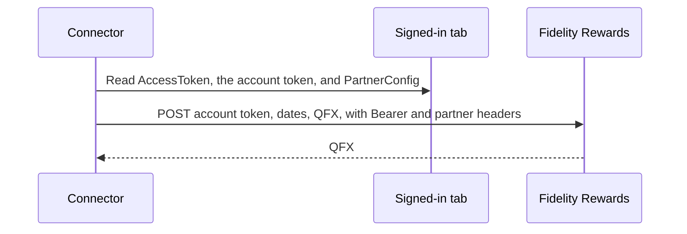

# Fidelity Rewards requests

## Purpose

The Fidelity Rewards card runs on a partner bank's platform. Its download needs a bearer token
that the page keeps in session storage. Last validated live: 2026-11-07. Not tested live: more
than one account.

## Context

The page does not request an account list. The sign-in signal is session storage: it holds
`AccessToken`, `multiAccountMetaData`, and `PartnerConfig`. The account token arrives about two
seconds after the dashboard loads.

## Flow

## Design decisions

- **Use `multiAccountMetaData`, not the selected-account value.** The site deletes the selected card
  after a download.
- **An end date of today becomes today plus four days.** The site sends this value.
- **The path contains GraphQL, but the body is plain JSON.**

## Terms

- **Bearer token:** a token that the request sends in its `Authorization` header.
- **Partner headers:** headers that name the partner bank's platform.
