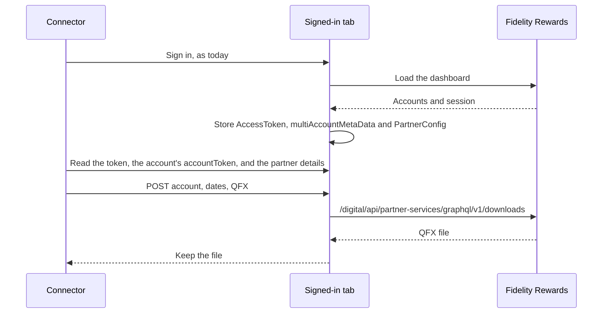
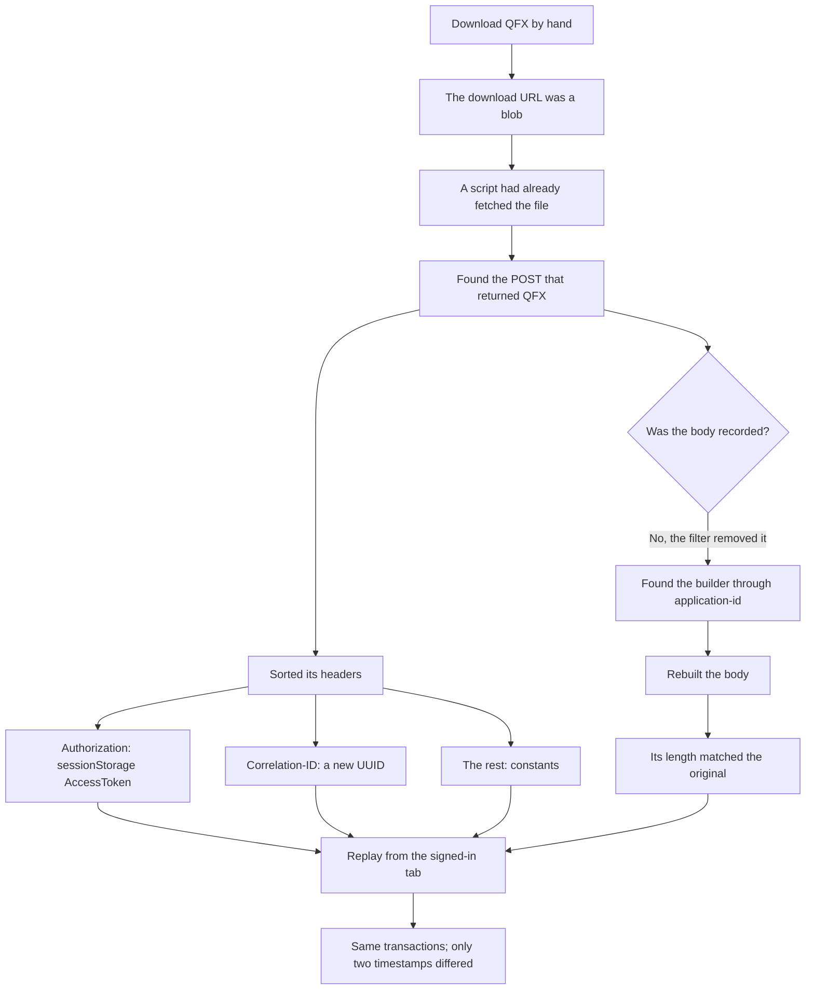

# Fidelity Rewards requests

Part of [reconstructing bank requests](README.md). Traced live on 2026-11-05.

## Finding

The Fidelity Rewards card runs on a partner banking platform. Its download has no CSRF token. It
uses a bearer token, which the page keeps in session storage where the connector reads it, and
one POST replaces the download dialog and the wait for a file.

## Direct flow



## How it was traced



## Steps

### 1. Read the session values

| Value | Where | Notes |
|---|---|---|
| Bearer token | `sessionStorage.AccessToken` | Sent as `Authorization: Bearer <token>` |
| Account token | `sessionStorage.multiAccountMetaData`, `accounts[].accountToken` | Stored as JSON |
| Last four digits | The same account, `details.cardLast4PAN` | Picks the configured account |

The connector uses `multiAccountMetaData` rather than `DIY_SelectedAccount_AccountToken`. That
second value
belongs to the download screen, and the site's script asks to delete the selected card after a
download.
The account token first arrives in a response about two seconds after the dashboard loads.

### 2. Send the request

`POST https://login.fidelityrewards.com/digital/api/partner-services/graphql/v1/downloads`. The
path says GraphQL, but the body is plain JSON. The answer is `application/vnd.intu.qfx`.

```json
{
  "requestType": {
    "serviceType": "ACCOUNT_TRANSACTION",
    "serviceSubType": "HISTORY_DOWNLOAD"
  },
  "data": {
    "accountToken": "<account token>",
    "searchBy": [],
    "startTime": "YYYY-MM-DD",
    "endTime": "YYYY-MM-DD",
    "fileType": "QFX"
  }
}
```

The script can add a `cardId` entry to `searchBy` for some accounts. The site also offers `CSV`
and `QBO` as file types.

### 3. Set the end date

When the end date is today, the site sends a date four days later. The connector does the same,
so its request matches what the site sends.

### 4. Send the headers

| Header | Value |
|---|---|
| `Authorization` | `Bearer <AccessToken>` |
| `Content-Type` | `application/json` |
| `Correlation-ID` | A new UUID |
| `application-id` | `RPCTRANDOWNLOADCRDTXN` |
| `customerPartnerId` | `sessionStorage.PartnerConfig`, `partnerInfo.partnerID` (`fid`) |
| `customerGroupId` | The same, `partnerInfo.groupID` (`ELAN`) |
| `customerPartnerLoc` | The same, `partnerInfo.loc`, a five-digit location code |
| `Service-Version` | `2`, written into the site's scripts |
| `routingKey` | Empty |

The site's own code builds the three partner headers from that partner object, and the page keeps
it in session storage, so the connector reads them there. The connector counts Fidelity as signed in
only once `PartnerConfig` is stored, beside the token and the accounts. The script chooses
`application-id` by a feature flag, and `RPCTRANDOWNLOAD` is the alternative.

Until 2026-11-07 the connector waited for a dashboard request carrying these headers and copied
them from Chrome's network log, because the location code's source was not known. It had been
missed: the code is in `PartnerConfig`, in `queryParam`, and in the site's scripts.

### 5. Check the answer

A failed download answers with JSON, which the site reads when the response is not `ok`. Keep
the file only when it holds `<OFX>`.

## Evidence

| Test | Result |
|---|---|
| Rebuilt body | Same length as the site's body |
| POST, same range as the click | Same tags and values, except `DTSERVER` and `DTASOF` timestamps |
| POST, 60-day range | Valid QFX that included the clicked transactions |
| POST from the signed-in tab, partner headers from `PartnerConfig` (2026-11-07) | `200`, QFX |
| Sync with the partner headers read from `PartnerConfig` (2026-11-07) | Succeeded |

## Not yet proven

- The request body was rebuilt from the site's script, so its exact bytes were not observed. Syncs
  succeed with it.
- Only one account was tested.
