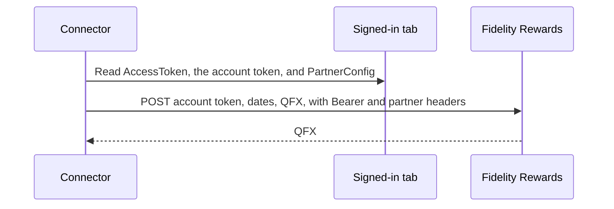

# Fidelity Rewards requests

## Purpose

The Fidelity Rewards card runs on a partner bank's platform. Its download needs a bearer token
that the page keeps in session storage. Traced live on 2026-11-05 and 2026-11-07.

## Sign-in

- **Signed in:** session storage holds `AccessToken`, `multiAccountMetaData`, and `PartnerConfig`.
  The page does not request an account list, so these three values are the signal.
- The account token arrives about two seconds after the dashboard loads.

## Requests

- **The partner headers come from `PartnerConfig`.** Before 2026-11-07 the connector copied them
  from a dashboard request in Chrome's log.
- **Use `multiAccountMetaData`, not the selected-account value.** The site deletes the selected
  card after a download.
- **An end date of today becomes today plus four days**, as the site sends it.
- **The path says GraphQL, but the body is plain JSON.**
- **An error comes as JSON.** omsync keeps a file only when it holds `<OFX>`.

## Tested

| Test | Result |
|---|---|
| Same range as the click | Same rows. Only two server timestamps differed. |
| 60-day range | Valid QFX with the clicked rows |
| Sync with headers from `PartnerConfig` | Succeeded |

Not yet proven: the exact request bytes (the body was rebuilt from the site's script); more than
one account.
