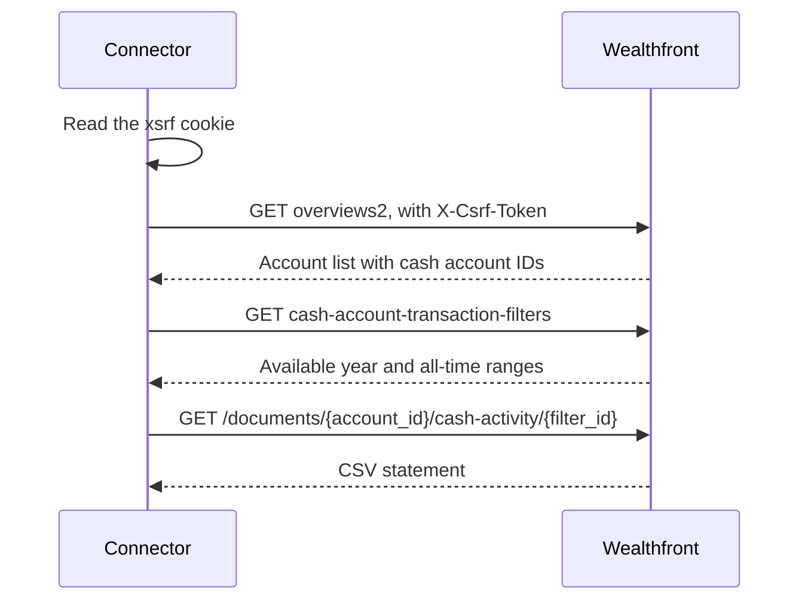

# Wealthfront requests

## Purpose

Wealthfront cash accounts export activity as CSV files. Each request repeats the `xsrf` cookie
as an `X-Csrf-Token` header. Last validated live: 2026-11-24. Not tested live: investment and
bond-ladder accounts.

## Context

The sign-in signal is the account list from `/capitan/v1/accounts/overviews2`.

- **Signed in:** the endpoint answers HTTP 200 with all user accounts.
- **Signed out:** the request is rejected with HTTP 401 or HTTP 403.
- **Account numbers:** internal account IDs map to account names through the
  `get_account_ids_for_user` and account details endpoints.

## Flow

## Design decisions

- **Direct document download over transaction JSON.** The CSV from the documents endpoint matches
  what the web download button provides and survives UI changes.
- **Support both account number and external ID last four.** The connector registers both the
  account number's last four digits and the external ID's last four characters to match either
  configuration.

## Terms

- **`xsrf`:** the session cookie passed as the `X-Csrf-Token` header.
- **Filter ID:** the time range identifier (`all`, `2026`, `2025`).
