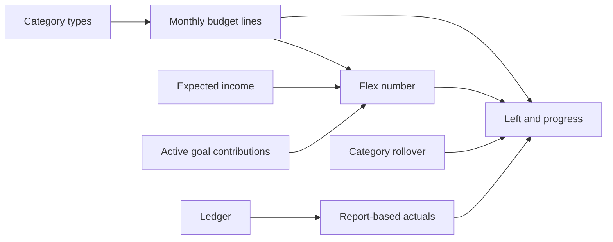

# Budgets

## Purpose and design philosophy

Budgeting plans future spending while keeping actual spending tied to the ledger. Monarch's
flex-budget concept inspires a choice between one flexible spending number and individual
category budgets. Switching presentation must not erase the user's budget data.

A **budget mode** selects flex or category budgeting. A category's **type** classifies an
expense as fixed, non-monthly, or flexible; income, excluded, and owed categories cannot be budgeted. A **rollover** carries a category's unspent or overspent
budget into later months.

## Behavior

Budget lines are monthly, nonnegative planned amounts, with one line per category and at
most one explicit flex-pool override. Category metadata determines how flex budgeting
presents them. Categories without a type remain visible as unassigned rather than
being silently folded into a spending pool.

In flex mode:

> Flex number = expected income − fixed budgets − non-monthly budgets − active goal contributions.

An explicit flex-pool amount replaces the calculated number for that month. Flexible actual
spending reduces its remainder. Flexible categories show actuals only in flex mode; their
stored lines are retained for category mode and never change the flex number.

The flex summary shows a bar per bucket, with spent and left, and a total row ends each
bucket's table with the same figures:

| Bucket | Budget | Carry | Left |
| --- | --- | --- | --- |
| Fixed | fixed budgets | none | budget − spent |
| Flexible | flex number | none | flex number − spent |
| Non-monthly | non-monthly budgets | rollover carry | budget + carry − spent |

Carry applies only to non-monthly categories in flex mode, and the bucket is marked when it
carries an amount in. In the current month the flexible bar shows how far through the month
today is; other months have no mark. Spending in categories with no type is one total
beside the buckets, outside the flex number. The Plan hub's budget card shows the flex number
with the same one-line explanation of where it comes from as the budget page.

In category mode, each category has its own planned amount and balance:

> Left = monthly budget + carry − actual spending.

Both modes call what is still available to spend Left.

Spending without a budget line is shown as unbudgeted, not added to budgeted totals.
Each category is shown with its [icon](categories.md) beside its name, in both modes: in the
tables, the not-budgeted list, and the categories over budget.
Switching modes retains all lines and settings. Copying a month is allowed only when the
destination has no budget lines, so it cannot overwrite work already done. Quick fill with
last budget, on the Fixed table, adds the previous month's line, with its rollover setting, to
each visible fixed category that has none this month; it never changes an existing line.

## Actuals and carry

Actuals use [report accounting](reports.md): splits count once, refunds reduce spending,
transfer and joint-settlement coverage is excluded, and excluded, owed, and uncategorized lines do
not become category actuals. Joint share applies consistently to actuals, income estimates,
and carry. Budget progress and reports must agree for the same month and setting.

A category's carry accumulates budget minus actual for earlier months where its line has
rollover enabled. Overspending carries negatively. A carry explains itself on hover and focus
as the budgeted and spent sums since the first month that contributed to it. Carry stays with
that category; it does not increase or reduce the general flex number. New non-monthly lines
in flex mode default to rollover on, because irregular costs are funded across months. Other
new lines default off. Editing a line does not reset its existing rollover choice.

Expected income uses an explicit override when set; otherwise it averages the three
complete months before the budget month, including zero-income months. This avoids treating
an incomplete current month as a full month's earning capacity.

## Flow

The Plan hub summarizes this month's budget and goals. Budget pages provide month navigation,
mode choice, income and flex overrides, category amounts, rollover, copy-last-month, and
quick fill.
All planning writes use [batches](changes.md), including mode and income changes.

Progress uses actual against available funds: under half is good, half to below full is
warning, and full or more is over. With nonpositive available funds there is no meaningful
ratio; positive spending still indicates over budget.

## Design rationale

Fixed expenses, irregular expenses, and discretionary spending need different planning
questions. Flex budgeting isolates what the user can control day to day; category budgeting
provides finer commitments without forcing a separate data model.

Rollover represents category funding, not new income. Keeping it out of the flex formula
prevents accumulated reserves from being presented as fresh disposable money. Goal
contributions reduce planned capacity but do not create spending transactions or transfers.
