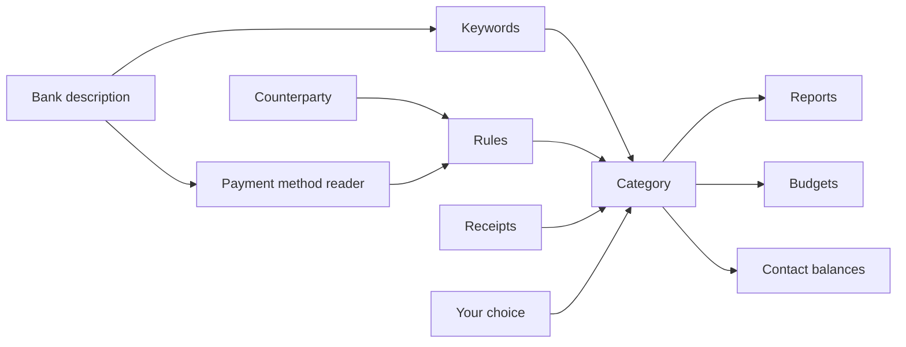
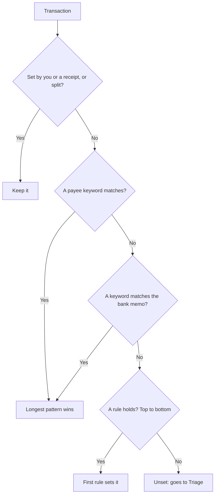
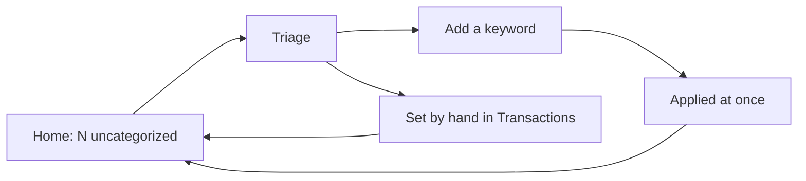

# Categories, keywords, and rules

## Purpose

A category says what money was for. Keywords and rules set categories for you. Each automatic
choice can be explained and changed.

## Context

## Flow

### How one transaction gets its category

### Clearing uncategorized transactions

## Design decisions

- **What was bought beats how it was paid.** A keyword always beats a rule.
- **The longer pattern wins.** `river park` beats `park`. There is no priority field. To change
  the winner, write a more specific keyword.
- **Keywords are your data. Bank wording is code.** Only you know your merchants. Every bank says
  "ZELLE" the same way, so omsync reads payment methods with Sure's wording reader. A word like
  `zelle` never competes with a store name.
- **A rule reads only what a transaction already has:** payment method, amount, counterparty, and
  account. A rule never changes what a keyword decided.
- **The first rule that holds wins.** Rules never chain. The result stays as easy to explain as a
  keyword.
- **The amount alone cannot tell a lunch from a transfer.** So a rule can require a person as
  the counterparty.
- **Keywords and rules apply when you save them.** You already saw the preview. Undo is the way
  back.
- **Automation never replaces your choice.** Your choices and receipts outrank keywords and rules.
- **A missing bank wording goes to Triage**, not to a wrong category.
- **Type sets how a category counts.** One field, so a category cannot be income and budgeted.

## Terms

- **Keyword:** a text pattern that sets a category. A list scopes it: Payees, or one receipt
  vendor's items.
- **Payment method:** how money moved: transfer, check, cash, PayPal, Square, and others.
- **Rule:** an ordered condition on payment method, amount, counterparty, or account that sets a
  category.
- **Triage:** uncategorized payees and receipt items, grouped so one choice covers many.
- **Type:** fixed, flexible, non-monthly, unassigned, income, excluded, or owed.
