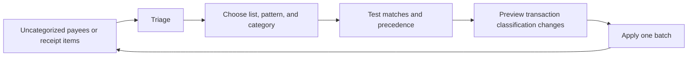

# Categories and keywords

## Purpose and design philosophy

Categories express what money was for. Keywords automate repetitive classification without
becoming a general-purpose rule system or replacing deliberate user choices. Every automated
choice must be explainable and revisable.

A **keyword** is a text pattern assigning a category. A **keyword list** defines its scope:
Unique and Generic for statement payees, or a vendor-specific list for receipt items.
**Categorize** applies those keywords to eligible transactions. **Triage** turns unresolved
payees and receipt items into reusable classification choices.

## Behavior

Categories have a name and a **type**: fixed, flexible, or non-monthly for the expenses a
[budget](budgets.md) plans; unassigned for an expense not yet classified; income for money that
counts as income in [reports](reports.md); or excluded for money reports leave out, as for transfers
and loan payments. One field carries all of it, so a category cannot be both income and budgeted,
and leaving a category out of reports is an explicit choice rather than a group name that has to be
spelled right. New categories are unassigned. Names are unique without regard to case. Hidden
categories remain on historical transactions but leave ordinary pickers. Deletion is refused while
any transaction, split, keyword, amount rule, or other data uses the category; hiding preserves
both history and a clean picker.

A category may also have an **icon**, any [Lucide](https://lucide.dev) icon; one with none shows
`shapes`. The icon is chosen in a dialog that searches the whole set by name and tag. It is
decoration for places that list categories as planning lines: the Categories table and the
[budget](budgets.md) page. The register and its pickers show names only, so a long list stays
scannable and the icon never competes with the amounts.

Categories are listed in one table, a row each. Name and type are edited in the row and save as the
cell is left or changed. The table sorts by name or type from its column headers and filters to one
type. Ticking rows sets a type, or hides or shows them, as one batch that undo reverses together.
The sort and filter belong to the view, not the data: they hold through every edit on the page and
are forgotten when it is left. The categories and the keywords of the open list are shown in full,
however many, each table scrolling inside its column under its header row while the controls around
it stay in view.

Unique keywords outrank Generic keywords. Within a list, priority wins first, then the
longer pattern, then stable creation identity. Patterns are case-insensitive and explicitly
choose regular expression or literal substring matching. Disabled keywords do not match.
A repeated pattern within its list is refused.

Statement classification starts with source payee text, falling back to display payee when
there is no raw text. Only when that text matches no keyword does it try source MEMO, and
the MEMO fallback uses Unique keywords only, because Generic patterns are loose payee
fragments that misfire on memo location text. A MEMO match must not override a payee match.
Receipt items use their vendor's own list.

An **amount rule** sends a small payee match elsewhere. When the winning keyword comes from a Unique
or Generic list and assigns category From, and the transaction's absolute amount is strictly below
the rule's limit, the transaction takes category To instead. The rule applies to the winner after
precedence is settled, so it covers a Unique MEMO match too; receipt vendor lists have no rules.
The amount is absolute, so a refund follows its purchase, and an amount equal to the limit does not
qualify. At most one rule applies and rules never chain: of those that qualify, the lowest limit
wins, then the earliest created. A rule must name two different categories, and a list has one rule
per From category and limit. Disabled rules do not apply. A category named by a rule cannot be
deleted, though it can be hidden. The result keeps keyword origin, so it is recomputed like any
keyword result.

Categorize changes only unset or keyword-origin, unsplit transactions. Manual and
receipt-origin categories and all split transactions are protected. A keyword-origin
category becomes unset if its keyword no longer matches. Running again with unchanged
rules and data changes nothing.

## Flow

The payee tester lists matching keywords in precedence order and marks the winner. Given an optional
amount, it also shows the amount rule that redirects the winner. Conflict
inspection identifies identical patterns pointing to different categories, including
across Unique and Generic. It titles the finding "Needs attention", lists each pattern with the
category each list gives it, and marks the keyword that applies, chosen by the precedence above.
Each entry links to its keyword row, which scrolls into view and flashes. Conflicts are visible
without pretending that syntactically different regular expressions can all be proven disjoint.

Triage groups repeated uncategorized payees and receipt-item text so the user can make one
useful choice instead of editing every occurrence. A suggested pattern is editable evidence,
not an automatically accepted keyword. Adding a keyword and applying categorization are
separate actions.

## Keyword import and changes

Keyword files map category names to lists of regular expressions. Import previews new
categories, new keywords, skipped duplicates, and safe parsing warnings. A trailing comma
can be accepted with its location reported; other malformed JSON or invalid patterns are
refused without repeating private contents. Newly named categories start unassigned.
Uploaded files are temporary input, not live configuration files.

Category, keyword, and amount rule edits (an icon choice among them), file import, and categorize
apply use [batches](changes.md).
A stale categorize preview is refused. Undo cannot erase a later user edit to a transaction
that categorization changed.

## Design rationale

Separating keyword scope makes a product description different from a statement payee:
the same word need not mean the same category in both. Explicit precedence keeps the
result deterministic rather than dependent on incidental query order.

One word can mean a four-dollar snack or a sixty-dollar dinner, so a keyword alone cannot always
choose a category. Amount rules answer that with a single threshold on a keyword's result, which
keeps them a refinement of keywords rather than a general rule engine, and keeps the outcome as
explainable as the keyword that produced it.

Origin protection distinguishes automation that may be recomputed from user decisions
that must remain authoritative. The database owns the live keyword lists; imported JSON
is a way to supply them, not a second source that silently overrides in-app edits.
