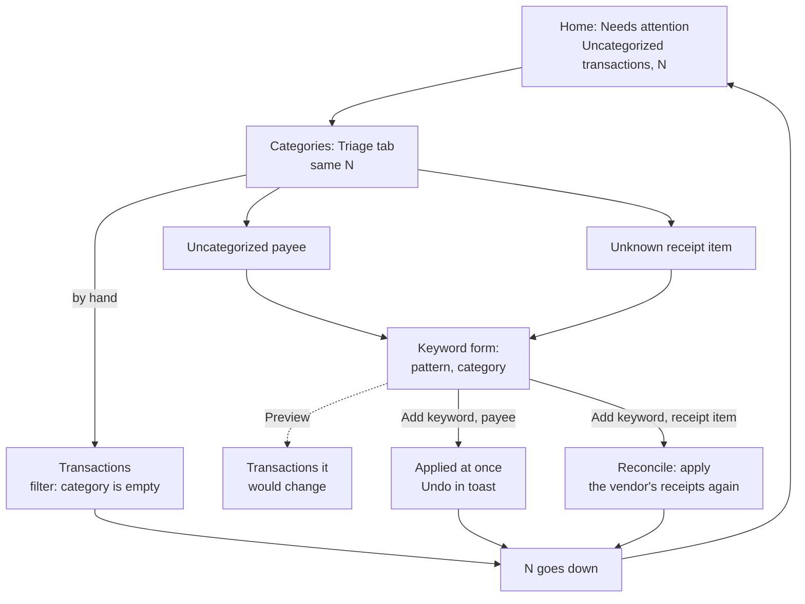

# Categories and keywords

## Purpose and design philosophy

Categories express what money was for. Keywords automate repetitive classification without
becoming a general-purpose rule system or replacing deliberate user choices. Every automated
choice must be explainable and revisable.

A **keyword** is a text pattern assigning a category. A **keyword list** defines its scope:
**Payees** for who was paid on a statement, or a vendor-specific list for receipt items. A
**payment method** is how the money moved (a transfer, a check, cash, PayPal, Square, and so on),
which omsync reads from the bank's wording. **Rules** categorize what no keyword matched, by payment
method, amount, other side, and account. **Categorize** applies keywords and rules to eligible
transactions; it runs after every keyword or rule change, so categories follow them at once. **Triage** turns unresolved payees and receipt items into
reusable classification choices.

## Behavior

Categories have a name and a **type**: fixed, flexible, or non-monthly for the expenses a
[budget](budgets.md) plans; unassigned for an expense not yet classified; income for money that
counts as income in [reports](reports.md); or excluded for money reports leave out, as for transfers;
or owed, which reports also leave out, for money between you and a contact that a
[contact balance](contacts.md#balances) counts, such as a loan. One field carries all of it, so a category cannot be both income and budgeted,
and leaving a category out of reports is an explicit choice rather than a group name that has to be
spelled right. New categories are unassigned. Names are unique without regard to case. Hidden
categories remain on historical transactions but leave ordinary pickers. A category nothing uses is
deleted plainly. One in use is deleted by **delete and move**: its uses move to another category as
one batch, which undo reverses. Transactions and splits move with their origin kept; keywords move
as they are; budget lines and recurring series move to the target; saved filters that name it and
rental category names are renamed to it, and rules that set it set the target. A month the target
already budgets refuses the move; nothing is merged, and the person chooses which to keep. Hiding keeps both history and a clean picker without moving anything.

A category may also have an **icon**, any [Lucide](https://lucide.dev) icon; one with none shows
`shapes`. The icon is chosen in a dialog that searches the whole set by name and tag. It is
decoration for places that list categories as planning lines: the Categories table and the
[budget](budgets.md) page. The register and its pickers show names only, so a long list stays
scannable and the icon never competes with the amounts.

Categories are listed in one table, a row each, on the Categories page in
[Settings](settings.md#categories). Name and type are edited in the row and save as the
cell is left or changed. The table sorts by name or type from its column headers and filters to one
type. Ticking rows sets a type, or hides or shows them, as one batch that undo reverses together.
The sort and filter belong to the view, not the data: they hold through every edit on the page and
are forgotten when it is left. The open keyword list has a search that keeps the keywords whose
pattern or category name contains the text, ignoring case, and shows how many match; it belongs to
the view in the same way. The categories and the keywords of the open list are shown in full,
however many, each table scrolling inside its column under its header row while the controls around
it stay in view.

The page has two sides. The left is the categories table, with **New category** in its header. The
right holds the tools that assign categories, as the tabs **Triage**, **Keywords**, and **Rules**,
with Triage first and opened by default. The payee tester, beside the keyword search, and keyword
import open as dialogs from the Keywords tab. Each dialog closes with an X or Esc and has one action,
so none has a Cancel button.

Every keyword and rule form, in Triage, Keywords, and Rules, ends with the same buttons, right-aligned:
**Clear** or **Cancel**, **Preview**, and the action (**Add keyword**, **Add rule**, or **Save** for
an edit).
Preview says how many transactions the draft would change and lists up to 50 of them, with their
current and new categories, in a list that shows about ten and scrolls; it writes nothing. A receipt
list's keyword changes no transaction there, so its preview says to apply that vendor's receipts again
instead. An add form is always on the page, so its first button is Clear, which empties what was
typed and the preview; Cancel closes an edit or a triage form.

Above the buttons, a form's fields read as what they make, on lines that wrap only when the space
runs out. A keyword form is one line: the pattern, which takes the width left over, Regex beside it,
then the category. A rule form holds more, so it has two fixed lines that share columns: Paid by,
under, and at least, then with, in, and the category it sets. Its controls have fixed widths, so
nothing moves while it is filled in; Paid by is a button that opens the methods and names the ticked
ones, cutting a long list short rather than growing.

Within a list, the longer pattern wins, then stable creation identity: the specific name beats
the general place word (`river park` over `park`). There is no priority to overrule it; to change
the winner, write a more specific keyword. Patterns are case-insensitive and explicitly choose
regular expression or literal substring matching. Disabled keywords do not match.
A repeated pattern within its list is refused.

Statement classification starts with source payee text, falling back to display payee when
there is no raw text. Only when that text matches no payee keyword does it try source MEMO, and a
MEMO match must not override a payee match. Only when neither matches does it read the payment
method. Receipt items use their vendor's own list.

The payment method is read from the start of the payee text by the wording of Sure's label
normalizer (ported from [Sure](https://github.com/we-promise/sure), AGPL-3.0), which covers banks in
the US, the UK, Canada, and Europe, and from a short list of US wordings omsync adds, found on real
statements. A marker such as `ONLINE TRANSFER`, `ZELLE`, `CHECK 1234`, or `ATM WITHDRAWAL` names a
transfer, a check, or cash; an aggregator prefix such as `PAYPAL *`, `SQ *`, or `TST*` names PayPal,
Square, or Toast; and a US ACH line (`… DES:… ID:…`) is a transfer. The wording lives in code,
not in the user's data: a bank wording that is missing goes to triage rather than to a wrong
category, and is a one-line addition.

A **rule** sets a category for a transaction no payee keyword matched, when all of its conditions
hold. A keyword always beats a rule, so what was bought beats how it was paid: a Square payment at a
bakery that has a keyword follows the keyword. Rules are an ordered list: they are tried top to
bottom, the first that holds sets its category, and a rule's result never triggers another rule. A
rule needs at least one condition, and a condition that is not set does not matter:

- **Paid by**: one or more payment methods, read from the bank's wording.
- **Amount**: the absolute amount is strictly under a limit, or at least a minimum, or both, which is
  a range whose limit is above its minimum. The amount is absolute, so a refund follows its
  purchase, and an amount equal to the limit does not qualify.
- **Other side**: a payment with a person, one contact, or one of your own accounts, which is the
  [other side](contacts.md#the-other-side) stored on the transaction. A payment is with a person when
  its stored other side is a contact of the person kind whose role is neither owner nor co-owner.
  With none stored, it is when the description is a payment that names a person in the wordings
  recognition reads, and the name is not your own money: none of your names or account nicknames, no
  tracked account named by its digits, no saved contact that is a business, the owner, or the
  co-owner, and not only words of the owner's name, each a given, middle, or family name or a letter
  that starts one, because a short wording such as the owner's given name alone may be the owner.
  Otherwise a name that no contact has counts as a person as written.
- **Account**: the account the transaction is in.

Keywords do all matching of who was paid. The winning keyword is the first hit among payee
keywords, with the MEMO fallback, and it sets its category with origin **keyword**. Only when none
matched are the rules tried, and the first that holds sets its category with origin **rule**; with
neither, the category is unset and the payee goes to triage. Your choices and receipts outrank both,
so categorize can rerun. The person condition reads the name a description gives only when no other
side is stored, as the rule above describes. A payment method alone sets nothing: a rule such as
"Paid by Transfer, Check or Cash → Transfer" says what it means. Disabled rules do not hold. A rule with
the same conditions as another is refused, because one of the two would never apply. Because the
order decides, a broad rule placed before a narrow one hides it; the payee tester and the transaction
say which rule decided.

Because a rule can read the stored other side, the [automatic
step](contacts.md#running-it-automatically) identifies the other side before it categorizes, while
categorizing on demand reads the other side as it is stored.

The **Rules** tab of the Categories page lists the rules in order, each as its sentence, with buttons
to move it up or down, a switch to turn it on or off, Edit, and Delete. The form for a new rule and for
an edit names every condition a rule has, so an edit keeps none that the form cannot show. Saving,
editing, turning on or off, moving, and deleting a rule each run the automatic step, so the categories
follow the rules at once; the toast says how many transactions changed, and undo reverses the change
and that step together. Keywords work the same way: adding (from Triage or Keywords), editing,
turning on or off, deleting, and importing keywords each run the automatic step, with the same toast
and undo. Nothing waits to be applied, so there is no separate categorize step on the page; `omsync
categorize` remains for the command line.

Categorize changes only unset, keyword-origin, and rule-origin transactions that are unsplit. Manual
and receipt-origin categories and all split transactions are protected. A category set by a keyword
or a rule becomes unset if neither still gives one. Running again with unchanged rules and data
changes nothing.

## Flow

Clearing uncategorized transactions starts on Home and has three ways out of Triage: a keyword for
payees, which applies when it is added; a keyword then applying the vendor's receipts again for
receipt items; and editing rows by hand in the register. Each brings Home's count down.

The payee tester lists matching keywords in precedence order and marks the winner. When none
matches, it names the payment method the wording shows. Given an optional amount, and whether the
payment is with a person, it also names the rule that decides the category, if one holds, even when
no keyword matched. Conflict inspection identifies identical patterns in one list pointing to
different categories. It titles the finding "Needs attention", lists each pattern with the category
each keyword gives it, and marks the keyword that applies, chosen by the precedence above.
Each entry links to its keyword row, which scrolls into view and flashes. Conflicts are visible
without pretending that syntactically different regular expressions can all be proven disjoint.

Triage groups repeated uncategorized payees and receipt-item text so the user can make one
useful choice instead of editing every occurrence. It opens with how many transactions have no
category, counted as Home's [Needs attention](dashboard.md#needs-attention) counts them, and a link
that lists them in the register for anyone who would rather set them by hand. A receipt item that
matched no keyword leaves its split line without a category; once a keyword covers it, applying
that vendor's receipts again fills the line in, because categorize leaves split transactions alone.
A suggested pattern is editable evidence, not an automatically accepted keyword: nothing is written
until Add keyword, and Preview shows first what it would change.

## Keyword import and changes

Keyword files map category names to lists of regular expressions. Import previews new
categories, new keywords, skipped duplicates, and safe parsing warnings. A trailing comma
can be accepted with its location reported; other malformed JSON or invalid patterns are
refused without repeating private contents. Newly named categories start unassigned.
Uploaded files are temporary input, not live configuration files.

Category, keyword, and rule edits (an icon choice among them), delete and move, and file import use
[batches](changes.md), and the categorizing that follows a keyword or rule change is a batch of its
own that undo reverses with it. A stale import preview is refused. Undo cannot erase a later user
edit to a transaction that categorization changed.

## Design rationale

Separating keyword scope makes a product description different from a statement payee:
the same word need not mean the same category in both. Explicit precedence keeps the
result deterministic rather than dependent on incidental query order.

A payee keyword says who was paid, and only the user knows the merchants they pay, so keywords are
the user's data. How money moved is the bank's wording, the same for everyone, so it is code shared
with Sure rather than a second keyword list for the user to maintain. Keeping the two apart is what
lets a word like `zelle` never compete with a store's name: the method is read only when no keyword
says who was paid. See [ADR 0003](../adr/0003-read-how-money-moved.md).

A payment no keyword names, such as a Zelle to a friend, can mean a four-dollar snack or a
sixty-dollar dinner. Rules answer that with conditions the transaction already carries: the payment
method, the amount, the other side, and the account. The amount alone cannot tell a lunch paid to a
friend from a transfer to your own account or a joint contribution, so a rule may be limited by who
is on the other side, which omsync already knows. Rules never change what a keyword decided: a rule
that could would need a hidden exception for each kind of condition, and a payee's keyword should
mean the same thing every time. A keyword names one category, so a payee that needs two, by amount,
is not expressible; none of the user's rules needed it. A rule reads only what a transaction already
carries, sets one category, and the first rule that holds decides, so the outcome stays as
explainable as a keyword.

Keywords apply when saved, as rules do, because a keyword is a deterministic choice the user has
just previewed. A separate apply step only left changes waiting, with no draft to discard: what
was waiting was recomputed from the saved keywords each time, so undo is the one way back.

Origin protection distinguishes automation that may be recomputed from user decisions
that must remain authoritative. The database owns the live keyword lists; imported JSON
is a way to supply them, not a second source that silently overrides in-app edits.
