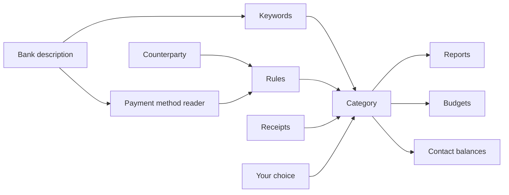
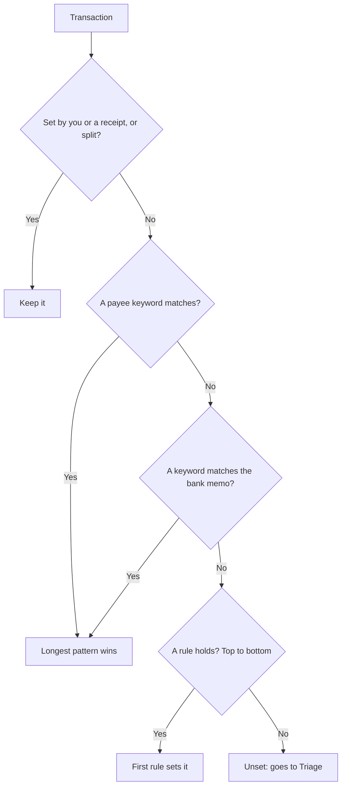

# Categories, keywords, and rules

## Purpose

A category says what money was for. Keywords and rules set categories for you.

## Context

## Flow

### How one transaction gets its category

## Design decisions

- **A keyword wins over a rule.** A keyword tells what you bought. A rule tells how you paid.
- **The longer keyword wins.** `river park` wins over `park`. There is no priority field. To
  change the result, write a longer keyword.
- **omsync reads the payment method from the bank's wording.** All banks write "ZELLE" the same
  way, so the reader comes from Sure, in code. A word such as `zelle` never competes with a store
  name in the keywords.
- **A rule reads only data that the transaction has:** payment method, amount, counterparty, and
  account. The first rule that matches wins. Rules do not chain.
- **A merge moves every use of one category to another, in one batch.** When a moved row
  duplicates a row in the target, such as a budget line for the same month, omsync stops the merge.
  You choose the row to keep.

## Terms

- **Keyword:** a text pattern that sets a category. A list scopes it: Payees, or one receipt
  vendor's items.
- **Payment method:** how money moved: transfer, check, cash, PayPal, Square, and others.
- **Rule:** an ordered condition on payment method, amount, counterparty, or account that sets a
  category.
- **Triage:** uncategorized payees and receipt items, grouped so one choice covers many.
- **Type:** fixed, flexible, non-monthly, unassigned, income, excluded, or owed. Excluded and
  owed money are not in reports.
