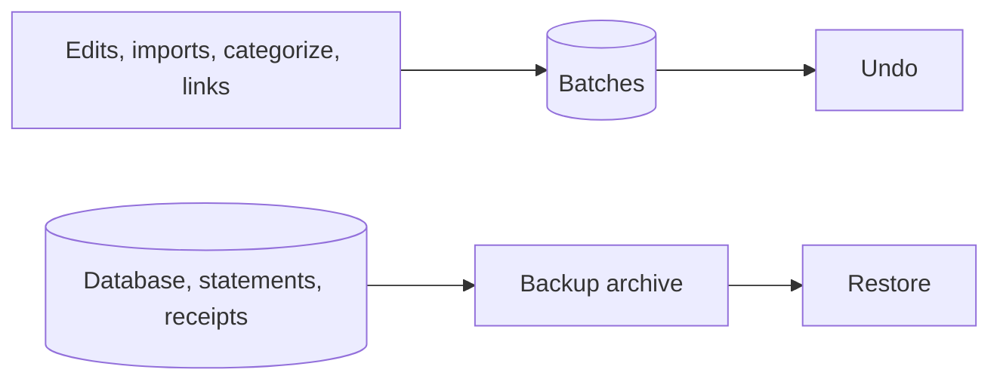
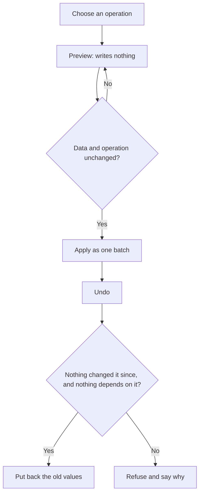
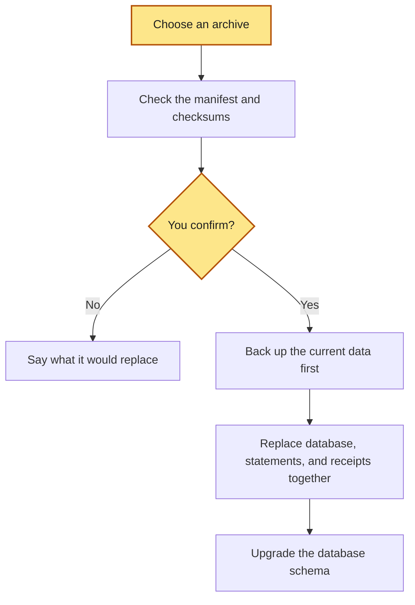

# Changes, undo, and backups

## Purpose

Each change to your money is one batch that you can undo. A backup keeps the database and the
statement and receipt files together, so a restore brings back the evidence too.

## Context

## Flow

### Apply and undo

An automatic batch that follows your change undoes with it, newest first. If one undo fails, none
applies.

### Restore

## Design decisions

- **Undo reverses one batch.** If a later batch changed the same data, undo stops and changes
  nothing.
- **Preferences are not batches.** Theme, layout, and joint share save directly.
- **A backup contains the statement files.** Without them, the database cannot show where a
  transaction came from. A backup does not contain credentials, vault state, browser sessions,
  exports, logs, or other backups.
- **Backups are not encrypted.** Keep them on protected storage. Restore only your own backups.
- **A restore replaces all data.** It does not merge. omsync first makes a backup of the current
  data. A restore writes the config file only if no config file exists.
- **A lock refuses a second operation.** The operation does not wait. The sync lock covers sync,
  receipt download, backup, and restore. The serve lock covers the server and restore.

## Terms

- **Batch:** all changes from one operation.
- **Preview:** what an operation would change, computed without a write.
- **Archive:** a `.tar.gz` file with the database, statements, receipts, the config file in use,
  and a checksum manifest.
- **Database copy:** an automatic copy before each schema upgrade. omsync keeps the newest few.
- **Snapshot:** a migrated copy in a new data directory, for tests. It is not a backup.

See [back up and restore](../how-to/back-up-and-restore.md) for the steps.
