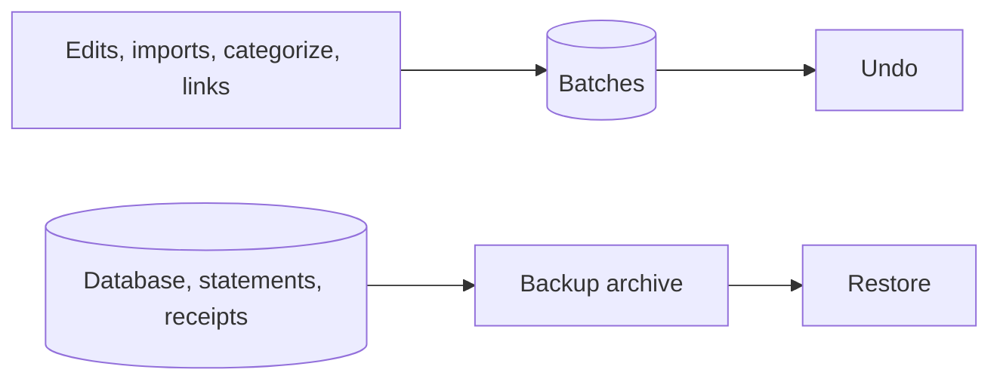
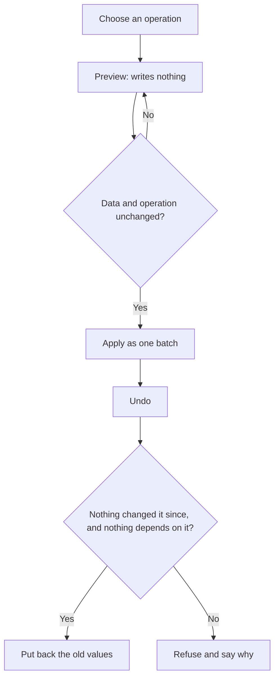
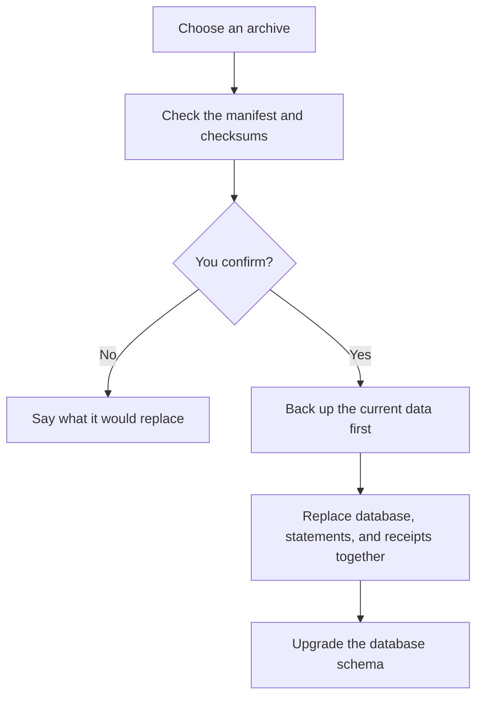

# Changes, undo, and backups

## Purpose

Each change to your money is one batch that you can undo. A backup keeps the database and the
statement and receipt files together, so a restore brings back the evidence too.

## Context

## Flow

### Apply and undo

An automatic batch that follows your change undoes with it, newest first. If one undo fails, none
applies.

### Restore

## Design decisions

- **Undo is a guarded reversal, not a rewind.** It refuses when a later change depends on the
  batch. Refusal is better than lost work.
- **A stale preview never applies.** You approve what you saw, or you see it again.
- **A retry never applies twice.** A repeated request returns the first batch.
- **Preferences are not batches.** Theme, layout, and joint share save directly.
- **A backup includes the evidence.** A database alone cannot explain itself without its
  statement files.
- **Credentials stay out of backups.** Vault, keychain, and browser sessions are not archived.
- **Archives are not encrypted.** Keep them on protected storage. Restore only your own archives.
- **A restore replaces everything.** It does not merge. It backs up the current data first.
- **A restore keeps the machine config.** An old archive cannot move the data directory.
- **The server and a restore never run together.** One lock covers sync, backup, and restore.

## Terms

- **Batch:** all changes from one operation.
- **Preview:** what an operation would change, computed without a write.
- **Archive:** a `.tar.gz` file with the database, statements, receipts, and a checksum manifest.
- **Database copy:** an automatic copy before each schema upgrade. omsync keeps the newest ten.
- **Snapshot:** a migrated copy in a new data directory, for tests. It is not a backup.

See [back up and restore](../how-to/back-up-and-restore.md) for the steps.
