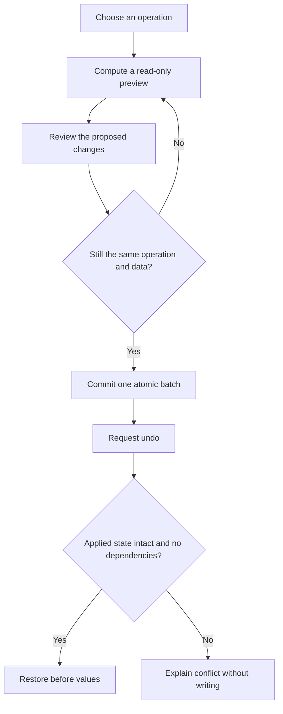

# Changes

## Purpose and design philosophy

A financial change must be explicit, atomic, repeatable, and reversible without destroying
later work. The unit of change is a **batch**: all database changes made by one operation.
The unit of review is a **preview**: what that operation would change against current data.

Undo is a guarded reversal, not a rewind of the whole application.

## Behavior

- Computing a preview writes nothing: no ledger rows, batch rows, revision rows, or files.
- A preview identifies both the data it was computed against and the exact proposed
  operation. Equal counts are not proof that two previews describe the same changes.
- Apply refuses a stale preview and writes nothing. The user must see a fresh preview
  rather than unknowingly approve a different operation.
- Apply commits all changes in a batch together. A failure rolls the batch back.
- An idempotency key identifies an application attempt. Repeating an applied key returns
  its original batch instead of applying twice. An undone key cannot be reused to apply
  a different operation.
- A batch records before and after values. Undo restores those values only while the
  affected data still matches the applied state and no later batch depends on it.
- Undo refusal identifies the conflict and changes nothing. Changes outside batches also
  count as conflicts; a matching batch number is not sufficient proof that undo is safe.

## Flow

An inline edit can preview and apply in one submission, but it still validates the version
shown when the editor opened. Bulk edits, imports, categorization, and receipts expose
explicit previews. Approving a reconciliation proposal revalidates the proposal against
current evidence. The automatic step after an import or sync applies the proposals that need no
review as one such approval, computed from the data just imported and refused as stale if it changes
first; it is a separate batch that undo reverses without touching the import. Undoing an import
whose transactions that batch linked is refused until the automatic batch is undone.

## Boundaries

Ledger changes and domain configuration use batches. Ordinary presentation preferences
such as theme, dashboard layout, and joint-share selection save directly. Operational sync
logs also save directly: they describe an external attempt, not an undoable financial
choice. Individual feature specs identify settings that are preferences rather than batches.

File downloads, external sign-ins, and vault operations are outside undo. Undoing an import
removes its database effects, not its retained statement file. A multi-file import is a
sequence of atomic batches, one per file, not a single transaction over every file.

## Design rationale

Idempotency protects against retries and double submissions. Stale checks protect against
reviewing one state and applying another. Neither replaces the other.

Before-and-after checks protect user work even when a write bypassed the normal batch
mechanism. Dependency checks protect relationships a later operation established. Refusing
an unsafe undo is preferable to silently erasing an edit or leaving a dangling relationship.

Financial data is durable; presentation preferences are convenience. Treating every theme
change as a financial batch would create noise without improving the user's ability to
recover their work.
