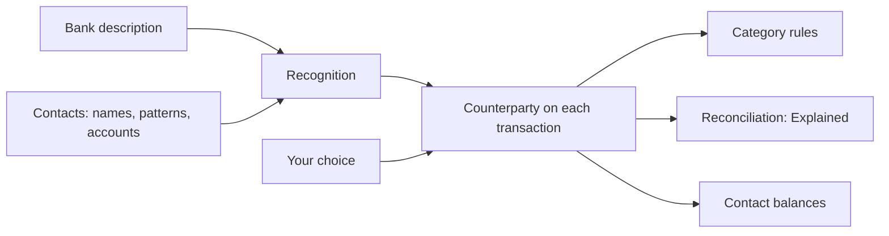
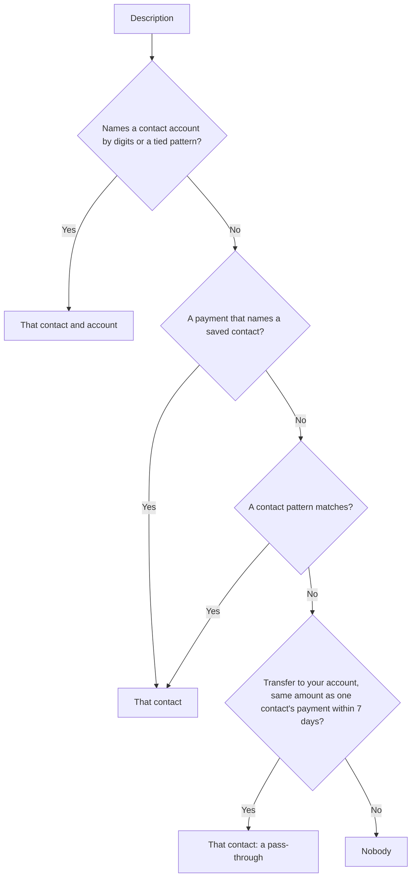
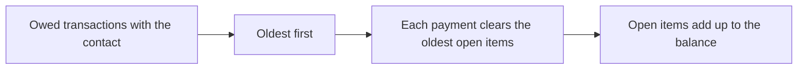

# Contacts and counterparties

## Purpose

Each transaction has a counterparty: who the money moved with. A contact is a person or business
that omsync knows by name. Contacts give the counterparty a name and keep a balance of loans.

## Context

## Flow

### Recognition

The first step that finds somebody wins. Two or more matches in one step find nobody.

### Balances

## Design decisions

- **A counterparty is never a category.** A category says what money was for. A category per
  person would misstate reports. A loan to a friend needs no counterpart. A loan through a tracked
  account does. The category cannot tell these apart.
- **A name is stored in parts.** Banks print a name in many orders and forms. omsync makes the
  forms from the parts. Each form keeps the given name, so a relative who shares a family name is
  not you.
- **The longest name match wins.** "ALEX J EXAMPLE" is the owner, and "JAMIE EXAMPLE" is the
  relative.
- **Your choice beats recognition.** Recognition never replaces it and never sets a split.
- **No guess when two match.** A step that finds two contacts finds nobody.
- **Only Owed money moves a balance.** Spending and income settle when paid.
- **Clearing is oldest first.** Several loans, part payments, and late repayments clear without a
  pairing rule.
- **You and your partner have no balance.** Money between the owners is shared.
- **The automatic step follows each change to contacts.** It undoes with your change.

## Terms

- **Owner:** the contact that is you. Your names find transfers between your own accounts.
- **Co-owner:** the other owner of the joint accounts.
- **Pattern:** a regex for bank wording that no name covers, for money out or money in.
- **Contact account:** an account outside omsync, found by its last four digits.
- **Nickname:** the name a payment app shows for one of your tracked accounts.
- **Pass-through:** money a contact paid you that you then moved through your own account.
- **Open item:** the part of a loan or payment that is not cleared yet.
