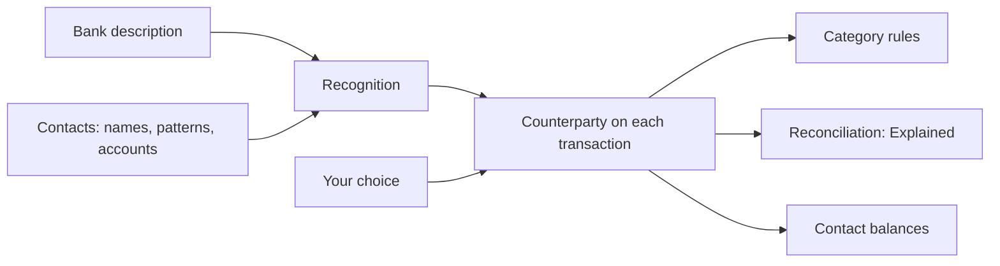
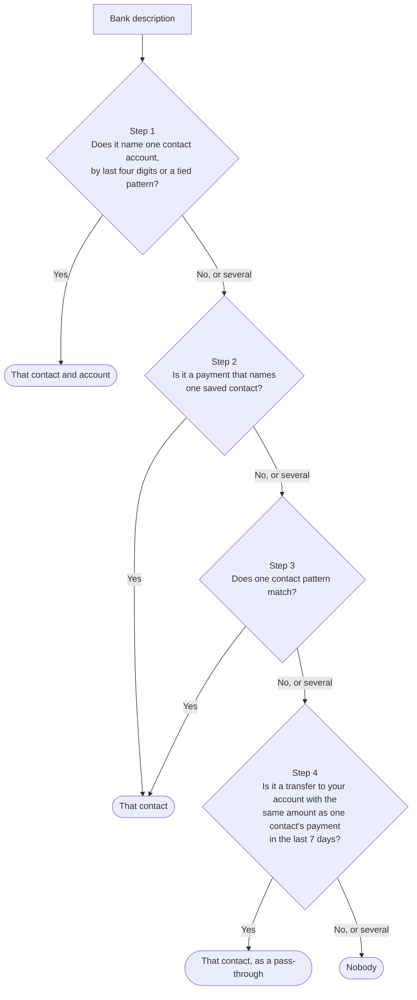
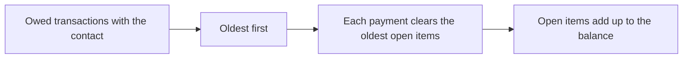

# Contacts and counterparties

## Purpose

Each transaction has a counterparty: who the money moved with. A contact is a person or business
that omsync knows by name. Contacts give the counterparty a name and keep a balance of loans.

## Context

## Flow

### Recognition

The first step that finds exactly one contact wins. A step that finds two or more contacts finds
nobody, and the next step runs.

### Balances

## Design decisions

- **The counterparty and the category are separate.** The category tells what the money was for.
  A category for each person would make reports incorrect.
- **omsync stores a name in parts.** Banks print a name in many orders and forms. omsync makes the
  forms from the parts. Each form contains the given name, so a relative with the same family name
  does not match you.
- **Only transactions in an Owed category change a contact's balance.** Spending and income are
  complete when paid.
- **A payment clears the oldest amount first.** Several loans, part payments, and late payments then
  clear without a pairing rule.
- **You and the co-owner have no balance.** Money between the owners is shared.

## Terms

- **Owner:** the contact that is you. Your names find transfers between your own accounts.
- **Co-owner:** the other owner of the joint accounts.
- **Pattern:** a regular expression for bank wording that no name covers, for money out or money in.
- **Contact account:** an account outside omsync, found by its last four digits.
- **Nickname:** the name a payment app shows for one of your tracked accounts.
- **Pass-through:** money a contact paid you that you then moved through your own account.
- **Open item:** the amount of a loan or payment that is not cleared yet.
