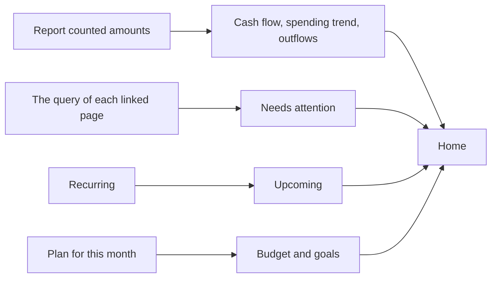
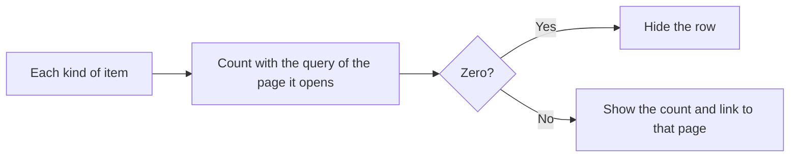

# Home dashboard

## Purpose

Home shows your cash flow and what needs doing. It uses the report numbers. It adds no new
accounting.

## Context

## Flow

### Needs attention

The kinds are import reviews, reconciliation to resolve, uncategorized transactions, recurring
items, and sync problems.

## Design decisions

- **Each count uses the query of the page it opens.** The count and the list always agree.
- **Upcoming amounts are labeled as expected.** They are not added to period totals, reports, or
  balances.

## Terms

- **Period sections:** cash flow, spending trend, and outflows.
- **Other:** a group of small categories, not a category of its own.
