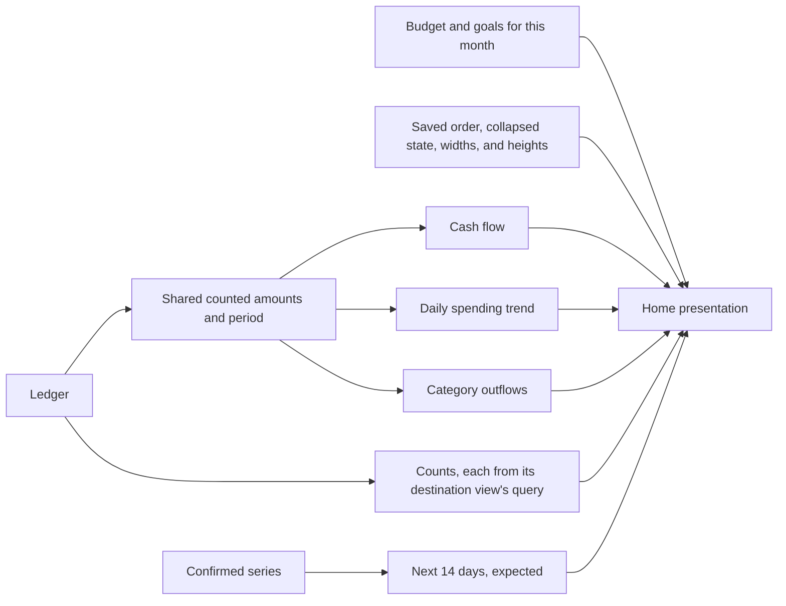

# Dashboard

## Purpose and design philosophy

Home provides a quick view of cash flow, and of what needs doing, without introducing
another accounting model. Sure inspires the section-based presentation. The user can
arrange the view around what they consult most often.

## Behavior

Home has seven sections. Cash flow, Spending trend, and Outflows follow the selected
period. Needs attention, Upcoming, Budget, and Goals follow today and ignore the period
picker, because they answer "what now" rather than "what happened". Each of them says so
in its header (Today, Next 14 days, This month), so no one reads them as period figures.

The period sections use [report counted amounts](reports.md), inclusive periods,
equal-length comparisons, and the shared joint-share preference. They make the selected
joint treatment visible. Home does not substitute a net-worth estimate for transaction
cash flow.

- **Cash flow** shows income categories feeding cash flow and expense categories receiving
  it, with surplus or deficit balancing the diagram. Category reversals flow in the
  opposite direction instead of being discarded. The diagram balances to the cent. Spending
  categories are the ones Outflows draws, and the rest are folded into one Other box, so a
  long tail of small categories cannot crowd the diagram; a category refunded past its
  spending stays its own box because it flows back. A category has one colour on the whole
  page: the colour Outflows gives it, and grey in Other, here and there alike. Income, the
  hub, and the surplus are green, the deficit red. A ribbon leaving the hub shades from
  green to its category's colour, so money visibly takes on the category it is spent on.
  Each category box shows its share of spending and opens the
  register for that category and period.
- **Spending trend** shows cumulative expenses by day against the preceding period.
  Each endpoint equals its corresponding report expense total.
- **Outflows** shows the largest categories and groups the remaining categories as Other.
  Refunds remain netted, including a negative Other amount. The figures sum to expenses;
  chart geometry must not be treated as a second source of totals.
- **Needs attention** lists the items below. A kind with nothing to show is hidden, and
  when everything is clear the section says so.
- **Upcoming** lists confirmed [recurring](recurring.md) occurrences due in the next 14
  days, today included, that are not yet paid, with the totals expected in and out. A date
  marked paid elsewhere counts as paid, and transfer series are left out of the totals. They
  are expectations, not ledger money, so they are labelled as expected and never added to
  period figures.
- **Budget** and **Goals** are the cards of the [Plan hub](budgets.md) for the month that
  contains today, each linking to its Plan page. Over-budget categories are not an
  attention item because the Budget card already shows them.

Category links open the register filtered to the period and category. Other is a collection
of categories, not a fictitious category with its own transactions. Figures accompany
charts so the financial result is not communicated solely by visual geometry.

## Needs attention

Every row links to the view that lists exactly the items it counts, and the count is taken
by the query that view is built on. A second definition of "these items" would let the
number and the list drift apart, so none exists. Uncategorized transactions opens Triage instead,
because a keyword that covers many of them is the usual way to clear them, not an edit per row.
Triage heads its tab with the same count, from the same query, and links to the register list.
[Categories](categories.md#flow) draws the whole flow.

| Item | Counted as | Opens |
| --- | --- | --- |
| Import reviews | Open [import reviews](import.md): unresolved statement rows | Register, Needs review |
| Reconciliation to resolve | What a [reconciliation](reconciliation.md) run over the last 90 days, the range Reconcile opens with, leaves for a decision: review and manual proposals plus not-matched transactions. Automatic proposals and transactions whose other side is known are not counted | Reconcile, with that range in the link |
| Uncategorized transactions | Transactions matching the register filter "category is empty", on any date: an unsplit transaction with no category, or a split one with a line that has none, as a receipt leaves an item no keyword matched | Categories, on the Triage tab, which shows the same count and links to the register with that filter |
| Recurring needing attention | The items in the Recurring Overview's Needs attention list for this calendar month: missed occurrences and open recurring questions, as in [recurring](recurring.md) | Recurring Overview, whose Needs attention list shows the same items |
| Balance check failures | Each open account whose [balance check](accounts.md) reports an issue, listed by name | That account's page |
| Sync problems | Each provider whose newest [sync](sync.md) run failed or needs user action, listed by name | Bank sync settings |

Reconciliation items are computed by a run, not stored, so Home runs the same engine the Reconcile
page does. For that reason the rail has no Reconcile badge: a badge appears on every
page and must stay a cheap count. Recurring items are limited to the current month because
the Recurring Overview's Needs attention list covers the current month; a longer lookback
would count items that list does not show.

## Flow and layout

Sections can be reordered with pointer or keyboard interaction and individually collapsed.
The default order is Needs attention, the three period sections, then Upcoming, Budget,
and Goals. The saved layout applies across periods and reloads.

Where there is room for two columns a section is **half width**, taking one column, or **full
width**, spanning both. Each section's width is its own setting, chosen in the section's size
menu. The spending trend, the one chart over time, also has a **height**: compact, auto (the
default), or tall. As in Sure, only time-series charts offer a height; the cash-flow diagram,
the donut, and the lists size to their content. The cash-flow section can also open its diagram
in a large dialog, where every label has room. A section whose rows are grouped gets an
Expand all / Collapse all button for its groups; no section has grouped rows yet. A section's
controls show while it is pointed at or holds focus, and always on a touch screen. By default Needs attention, Cash flow, and Goals are full width and the
other sections are half width, so the two period charts share a row and Upcoming sits
beside Budget. Sections keep one reading order whatever their widths: a dropped section
lands before the first section the pointer is before in that order, so over a half-width
section its left half places the drop before it and its right half after it. A lone
half-width section leaves the other column empty rather than pulling a later section up,
so what the page shows never differs from the order the keyboard moves through.

Two columns apply only while the page area is wide enough for them, about 56 rem, not by
screen size, because the open accounts panel takes room the screen alone does not show.
Below that width every section is full width and the width choice is hidden, and the saved
choice returns when there is room. Charts redraw to their section's width. It is a presentation
preference, not an undoable financial batch. Unknown saved sections are ignored. A section
missing from a saved layout, such as one added after the layout was saved, is placed after
the nearest section before it in the default order that the layout holds, or first when none
precedes it; so an existing layout gains Needs attention at the top rather than the end. A
layout that names no widths gets the default widths, and a section with no saved height is
auto. A column count saved by an earlier version is ignored. Invalid layout input, including a
height other than compact, auto, or tall, changes nothing.

## Design rationale

An overview is useful only if it reconciles with the detail. Using report totals prevents
a chart-specific exclusion or rounding rule from silently changing the story. Negative
category nets require honest labels even when a donut cannot represent negative area.

One colour per category lets the donut and the diagram be read against each other, which
is why the diagram follows Outflows' grouping rather than listing every category. Colours
follow rank, so a category's colour can change when the period ranks it differently, in
both charts together.

Layout customization changes emphasis, not underlying figures. Widths are a per-section
choice because the sections differ: a chart reads well beside another, a sankey needs the
room, and a list is the same at either width. Placement stays in reading order, rather than
letting later sections fill gaps, so the keyboard, a screen reader, and the eye agree. It therefore persists
independently from ledger edits and does not clutter the financial change history.
