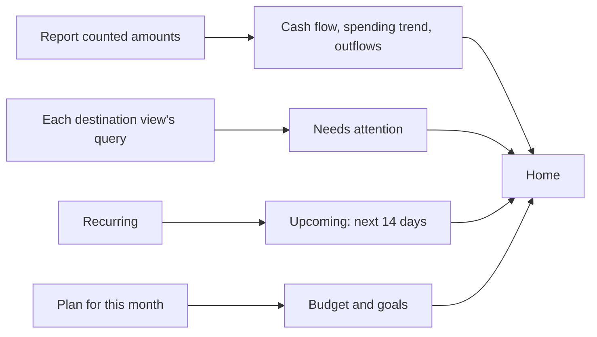
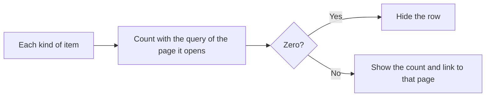

# Home dashboard

## Purpose

Home shows your cash flow and what needs doing. It uses the report numbers. It adds no new
accounting.

## Context

## Flow

### Needs attention

The kinds are import reviews, reconciliation to resolve, uncategorized transactions, recurring
items, balance check failures, and sync problems.

## Design decisions

- **Each count uses its page's own query.** A second definition would let the count and the list
  drift apart.
- **Period sections follow the period picker. The others follow today.** Each header says which.
- **Upcoming is expected money.** It is labelled as expected and never added to period figures.
- **One color for each category on the page.** The donut and the cash-flow diagram read together.
- **Figures go with every chart.** A chart's shape is never the only source of a number.
- **Layout is a preference.** Order, width, height, and collapse save directly, not as batches.
- **Sections keep one reading order.** A gap stays a gap, so the keyboard, a screen reader, and
  the eye agree.

## Terms

- **Period sections:** cash flow, spending trend, and outflows.
- **Other:** a group of small categories, not a category of its own.
