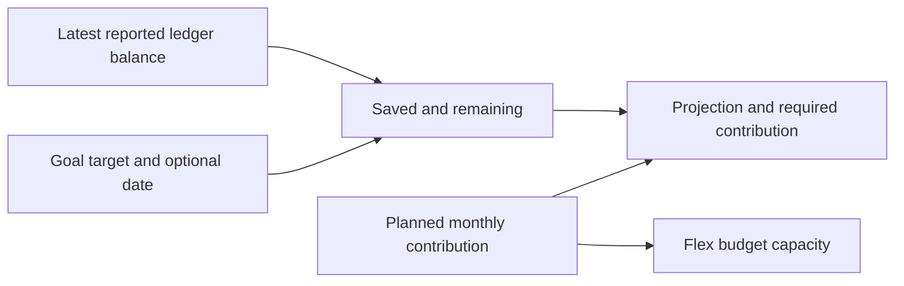

# Goals

## Purpose and design philosophy

A goal expresses an intended financial target, not a second balance ledger. Sure inspires
the progress and projection presentation. Progress must remain traceable to reported
account evidence; planned contributions must not masquerade as actual savings.

## Behavior

A goal has a name, target amount, optional target date, optional linked account, monthly
contribution, and optional visual identifiers. It can be archived without erasing it.
Unarchived goal contributions reduce the [flex number](budgets.md).

Saved progress is the linked account's latest reported ledger balance, with negative values
counted as zero. A goal without an account or reported balance has zero saved progress.
Available balances are not substituted. Closing a linked account does not erase its last
reported balance. Several goals linked to the same account do not reserve independent
portions of its money.

Remaining is the target less saved progress, never below zero. Progress is capped at the
target. Projections use the remaining amount and planned monthly contribution, rounded up
to whole monthly contributions. A completed goal projects today; a positive remainder with
no contribution has no projected completion date.

A target date supports a required monthly amount and an on-track/behind comparison.
Calendar calculations respect month ends instead of assuming every month has the same
number of days. Projections describe the plan, not a guarantee of future deposits.

## Flow

The goals list summarizes targets, progress, and status and can show archived goals. Goal
detail shows the linked account and balance date alongside its projection, so stale source
evidence is not presented as an observed balance today. Create, edit, archive, and delete
are [batches](changes.md).

## Design rationale

An account link is a simple, inspectable progress source. It is not an earmarking system:
omsync does not allocate or pledge parts of an account across goals. Summing overlapping
goal displays must not imply that the same account money exists twice.

Monthly contributions are planning inputs. They affect the budget but do not increase a
goal's saved amount until a later reported balance supplies that evidence. Separating plan
from observation prevents optimistic projections from contaminating actual finances.
