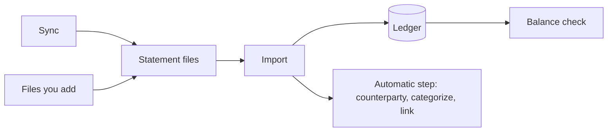
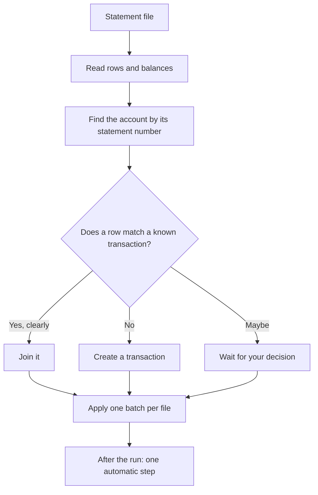

# Statement import

## Purpose

Import turns statement files into transactions. Overlapping files must not count money twice.
Two real purchases that look the same must not become one.

## Context

## Flow

## Design decisions

- **Doubt goes to review.** omsync never guesses a join. An uncertain row waits for you.
- **A trusted bank ID beats a matching payee.** Two different trusted IDs are two purchases, even
  with the same date, amount, and payee.
- **Some bank IDs are not trusted.** Citi changes its IDs between downloads. Chase gives a
  purchase and its foreign fee one ID. For these banks, the ID is only a hint.
- **Identical same-day purchases join one for one.** One match never merges all of them.
- **One batch per file.** A bad file fails alone. The other files import.
- **Importing a file again does nothing.** The file's content identifies it.
- **The automatic step runs once per run, not per file.** The two sides of a transfer often come
  in different files.
- **Dates are the bank's calendar dates.** A late-evening purchase does not move to the next day
  through a time zone change.
- **Chase cuts the description at 32 characters.** omsync joins the Chase NAME and MEMO into one
  description. Other banks keep MEMO separate.
- **Never guess a parse.** A Bank of America CSV row with doubtful columns is refused, because a
  wrong guess changes money.
- **Venmo and PayPal statements are not imported.** The sender writes free text, so nothing can
  match it.

## Terms

- **Join:** a row is a transaction omsync already has.
- **Statement format:** the reader for one bank's files.
- **Connector:** the code that downloads files. Import does not depend on it.
- **Description:** the text that rules and keywords read. It is NAME, or NAME and MEMO for Chase.
