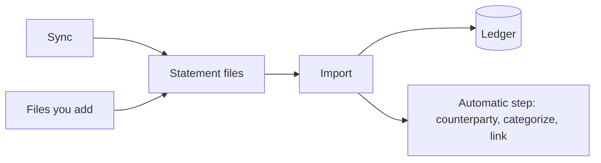
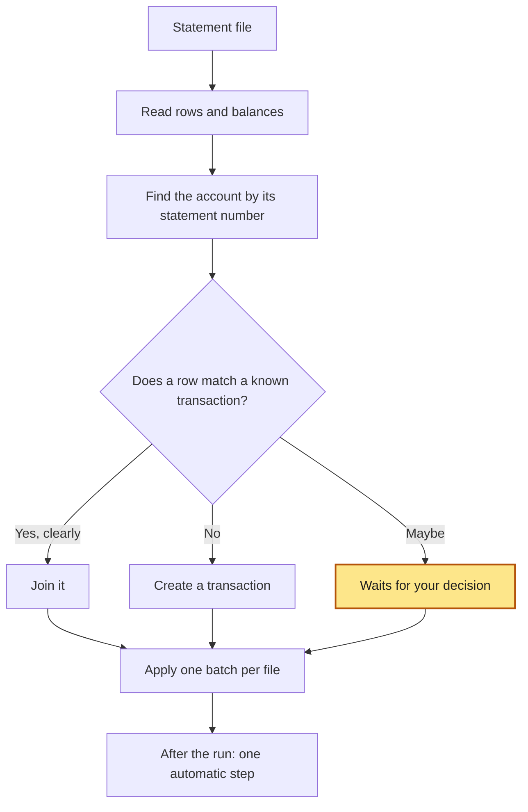

# Statement import

## Purpose

Import turns statement files into transactions. It counts each transaction once, also when files
overlap. It keeps two real purchases apart, also when they look the same.

## Context

## Flow

## Design decisions

- **A row joins a known transaction only when the match is certain.** Other rows wait for review.
- **A trusted bank ID decides a join.** Two different trusted IDs are two purchases, even with the
  same date, amount, and payee. Citi and Chase IDs are not trusted: Citi changes them between
  downloads, and Chase gives a purchase and its foreign fee one ID.
- **Identical purchases on one day join one for one.** One match does not join all of them.
- **The automatic step runs once per import run.** The two sides of a transfer often come in
  different files.
- **Dates are the bank's calendar dates.** A time zone conversion does not move a late-evening
  purchase to the next day.
- **Chase cuts the description at 32 characters.** omsync joins the Chase NAME and MEMO into one
  description. Other banks keep MEMO separate.
- **A Bank of America CSV row with unclear columns is refused.** An incorrect parse changes amounts.
- **Statements come from banks and card issuers only, not Venmo or PayPal.** On those, the sender
  writes the description, so it cannot match a transaction.

## Terms

- **Join:** a row is a transaction omsync already has.
- **Statement format:** the reader for one bank's files.
- **Description:** the text that rules and keywords read. It is NAME, or NAME and MEMO for Chase.
