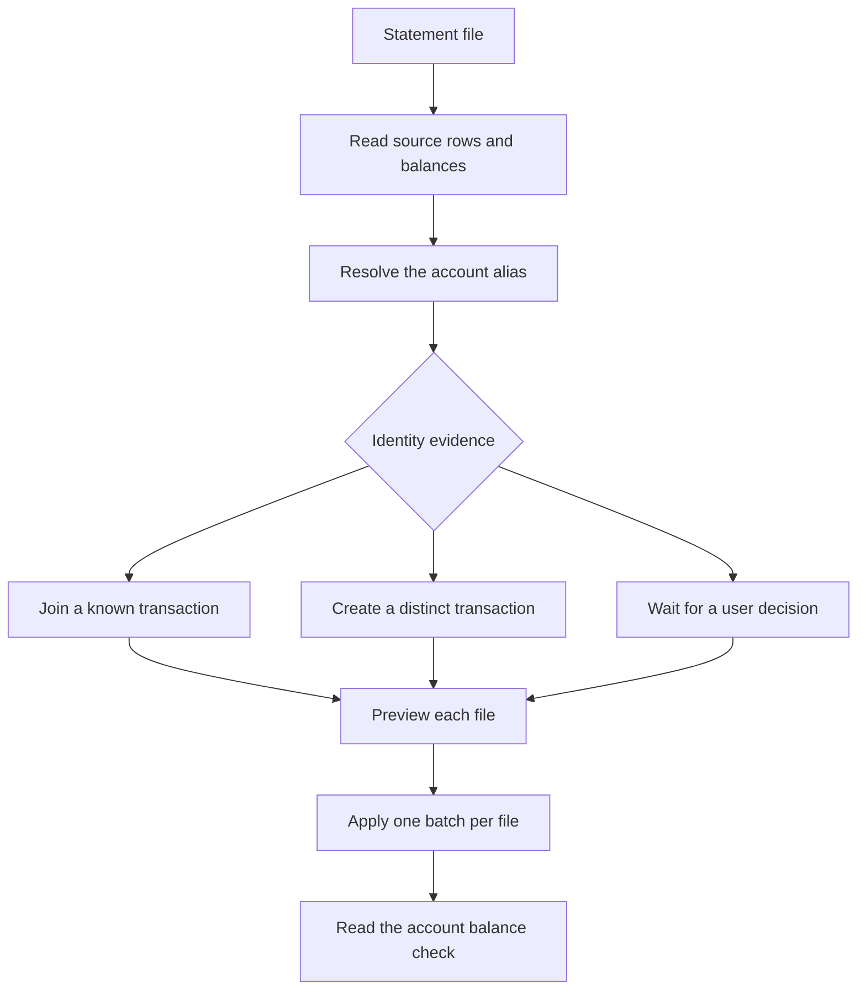

# Statement import

## Purpose and design philosophy

Import turns institution evidence into durable transactions without multiplying money when
files overlap or collapsing genuinely repeated purchases. Uncertainty is a review decision,
not permission to guess.

A **statement format** reads a file and supplies match evidence. A **connector** obtains
files. Import does not depend on which connector, if any, supplied the file.

## Behavior

Import accepts OFX/QFX bank and credit-card statements and the supported Bank of America
CSV layouts. It reads statement rows and balances, maps the statement account to a ledger
account, and previews three outcomes for each row:

- **Join** a known transaction when the identity evidence agrees.
- **Create** a transaction when the row represents a distinct money movement.
- **Review** when the row may describe an existing transaction but the evidence is ambiguous
  or contradictory.

Source rows retain their reported fields, file identity, and position. Joined rows do not
overwrite user edits. Import itself does not categorize; the [automatic reconciliation](reconciliation.md) after it
categorizes first, and `omsync categorize` runs the same step on demand.

A file's content identity makes importing it again a no-op. Each applied file is one atomic
[batch](changes.md). A bad file reports its failure without preventing other valid files
from being imported. Imported source files are retained without overwriting existing files.

After an import run that imported any file, [reconciliation](reconciliation.md) links the
proposals that need no review, once for the whole run and not per file, because the two sides of a
transfer usually arrive in different files. That is one further batch, and the result says how many
links it made. A run that imported nothing does not reconcile.

## Identity decisions

A trusted institution transaction ID is stronger identity evidence than a matching payee.
If an existing ID returns with a changed date or amount, the row goes to review rather than
silently altering the transaction. Two different trusted IDs represent distinct purchases,
even when their date, amount, and payee are identical.

When IDs cannot be trusted, account, posted date, amount, payee text, and occurrence counts
provide evidence. Identical same-day purchases must join one-for-one: matching one row is
not permission to merge every row with those details. A possible correction near an existing
transaction goes to review rather than creating an unexplained duplicate.

Trust belongs to the statement format and is retained with the row. Citi changes FITIDs
between downloads, and Chase gives a purchase and its foreign transaction fee the same FITID;
their IDs are hints, not transaction identity. Bank of America card
reference numbers are also hints rather than guaranteed stable IDs.

Review lets the user identify the existing transaction or create a new one. Resolving a
review is itself a batch, so undo restores the unresolved row.

## Source-specific rationale

**OFX dates** are the calendar dates printed by the institution, not dates obtained by
converting its timestamps to UTC. A late-evening transaction must not move to the next day
because a parser normalized its time zone. NAME and MEMO stay separate on the statement row,
exactly as the file reported them, and the row's fingerprint uses NAME alone so overlapping
files still join. MEMO supplies the payee when NAME is absent.

A new transaction's payee and raw payee are the row's **description**, and its memo starts
empty: the memo is the user's, and no source MEMO is copied into it. The description is NAME
for most institutions, because their MEMO is a separate field, such as Fidelity's reference
number, MCC, and card line. Chase and Chase Business cut NAME at 32 characters and continue the
description in MEMO, so their description is NAME and MEMO joined: with no space when NAME is
exactly 32 characters, since the cut falls inside a word, and with one space otherwise. The
format registry marks which formats join; import and [reconciliation](reconciliation.md) read
a row's description through the same function. [Categorization](categories.md) matches that
description and can fall back to source MEMO.

**Bank of America CSV** does not name its account, so its folder or an explicit account ID
supplies that identity. Checking files include a summary and running balances. The printed
beginning balance is before that date's activity and therefore belongs to the preceding
day for balance comparisons. Rows with no amount can be balance rows, not transactions.

Nested quoting and commas can make BoA descriptions look like extra columns. An unquoted
thousands separator can produce the same shape. Checking running balances validate the
interpretation; card files have no such chain, so doubtful amount boundaries are refused.
Guessing a parse is not acceptable when it can silently change money. Error messages name
the file and row, never repeat private row contents.

Balance checking belongs to [accounts](accounts.md). It identifies inconsistent evidence;
it does not force a join, delete a duplicate, or generate a balancing transaction.
