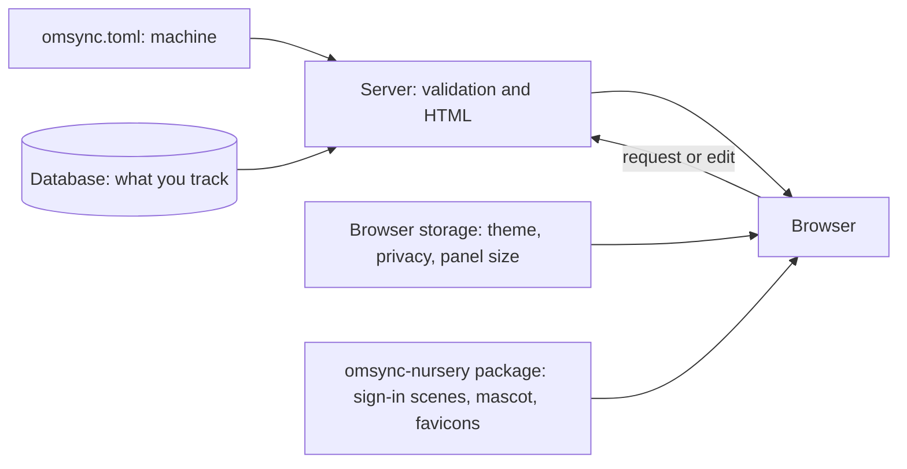
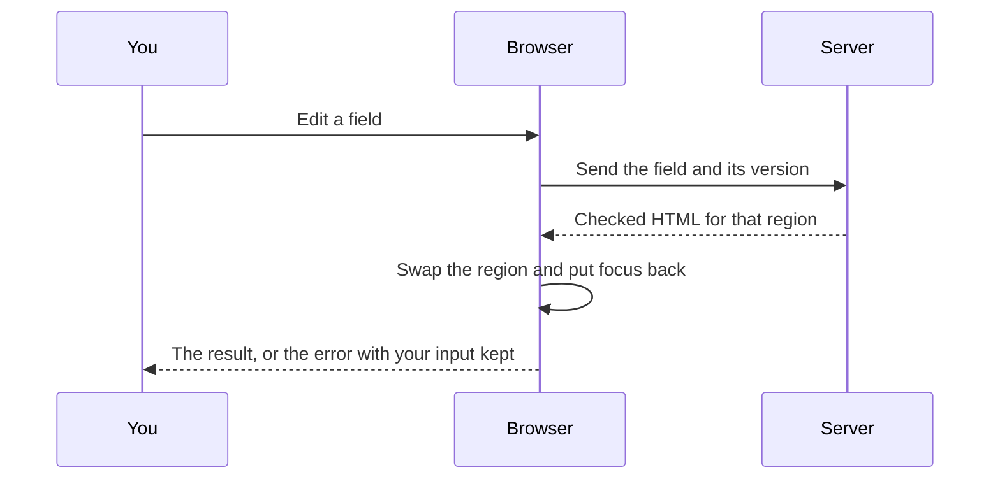
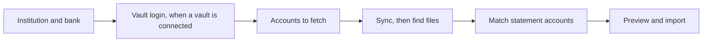
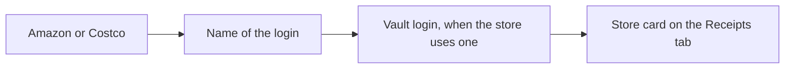

# Interface and settings

## Purpose

The server renders each page and checks each edit. This page also says where each kind of setting
is stored.

## Context

## Flow

### One edit

### Add a bank

### Add a store

## Design decisions

- **Each setting has one location.** Machine settings are in `omsync.toml`. Tracked data is in the
  database. The look on each device is in browser storage. For secrets, see [access](access.md).
- **The vault is set where it is used, on the Data sync page.** It has no Settings page of its
  own.
- **Data sync has one tab for banks and one for stores.** Each provider is a card with Sync, Edit,
  and Delete. Sync all is in the page header.
- **Privacy mode blurs amounts on the screen.** It is not access control. Exports are not blurred.
- **Pages show only the last four digits of an account number.** The full number does not go to the
  browser. Account mapping uses short-lived tokens.
- **The sign-in art is in a separate repository, `omsync-nursery`.** Art changes do not appear in
  the omsync history. Only a contract change touches both repositories.

## Terms

- **Rail:** the icon navigation on the left. It becomes bottom navigation on a phone.
- **Accounts panel:** the list of accounts beside the page.
- **Guides:** short walkthroughs in Settings. Read marks stay in this browser.
