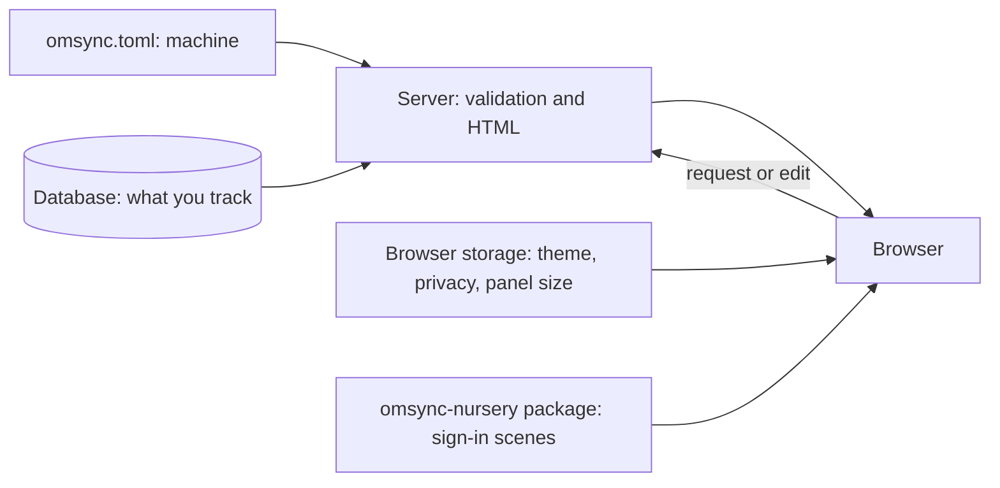
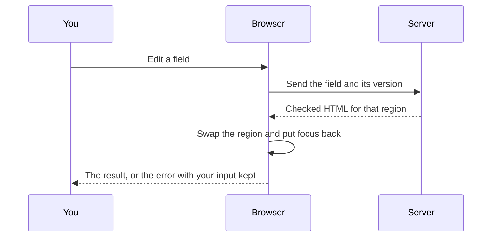
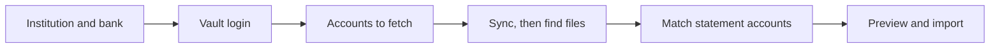

# Interface and settings

## Purpose

The interface makes your money easy to read and repeated work quick. Settings keep each kind of
choice in one clear place.

## Context

## Flow

### One edit

### Add a provider

## Design decisions

- **The server owns every financial rule.** JavaScript moves focus, opens dialogs, and draws
  charts. It never holds a second copy of the rules.
- **Focus restore is part of each swap.** A swap removes the focused field. Without a restore, the
  keyboard stops working.
- **Every page header has one shape.** A title, a line under it, and at most three controls:
  Joint accounts, the period, and a ⋯ menu. A new action goes in the menu.
- **Each kind of setting has one home.** Machine settings are in `omsync.toml`. What you track is
  in the database. Device look is in browser storage. Secrets are in the keychain and vault.
- **Only database changes are batches.** Theme, layout, and joint share save directly. A page
  offers Undo only for a batch.
- **Privacy mode only blurs.** It is not access control. Exports stay readable.
- **Full account numbers never reach the page.** Mapping uses short-lived tokens. Labels show the
  last four digits.
- **Hidden form values are input, not authority.** The server checks each wizard step again.
- **Categories live in Settings.** You set them up once and come back sometimes. Daily work stays
  on the rail.
- **The sign-in scene is a toy.** It holds no data. It comes from the `omsync-nursery` package.
  A click on the elephant waters it once. A hold fills it, and the release waters one stage for each
  half second held, up to eight.
- **The art follows a release branch.** The package comes from the nursery's `release` branch.
  `uv.lock` records the exact commit. omsync takes new art only when you run
  `scripts/upgrade-nursery.sh`. A release outside the range `>=0.1.1,<0.2` is a contract change: host code and the range change in one commit. The scene colours load from the package, not from the app's CSS.
- **Browser storage can fail.** The page then uses defaults and still works.

## Terms

- **Rail:** the icon navigation on the left. It becomes bottom navigation on a phone.
- **Accounts panel:** the list of accounts beside the page.
- **Guides:** short walkthroughs in Settings. Read marks stay in this browser.
- **Demo mode:** made-up data. A Demo pill shows in the top bar. Bank sync is off.
