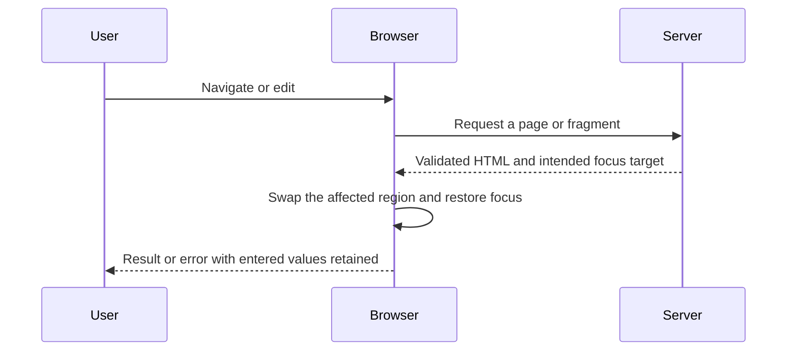

# Interface

## Purpose and design philosophy

The interface makes financial state legible and repeated work quick. It uses Sure's visual
language and page composition as inspiration, and Actual Budget's keyboard-first register
interaction. These are design influences, not requirements to reproduce another product.

The server owns financial validation. Browser controllers own focus, navigation, dialogs,
and charts. An interaction must not depend on a second financial model in JavaScript.

## Behavior

The desktop shell has an icon rail, a resizable and collapsible accounts panel, and the
active page. Navigation groups tracking, transaction work, and planning. Settings and
sign-out live in the user menu; configuration that is set up once and revisited, such as
categories and keywords, lives in Settings rather than on the rail. The Guides, the first section of Settings, are short walkthroughs of each page with read marks kept in this browser. A Guides link in the top bar and the first item of the user menu open them, so a newcomer finds them without knowing they live in Settings. On small screens the rail becomes bottom navigation and
the accounts panel becomes a dismissible overlay; wide tables scroll inside their region. A page
built around long tables, such as the register or Categories, fills the window on large screens, so
each table scrolls under the controls above it while its header row stays in view; on small
screens the page scrolls as a whole. Menus open toward the side with room: those at the left of
the content extend right, so they never open under the accounts panel.

Shared components provide buttons, cards, dialogs, menus, tabs, tables, notices, and inputs.

Every page header has the same shape: the title and a line under it that says what the page shows
in words, and on the right at most three controls, in this order. **Joint accounts** shows My
half or Full and opens the choice. It is one setting for the whole app, so every page whose
amounts it changes (Home, Reports, Budget) has the same control, and changing it on one changes
it on all; it is shown only when an account is joint, and account balances always stay in full.
The **period** is a button showing the current choice, opening the presets and Custom; Custom's
two dates appear in one row under the header and apply as soon as both are whole and in order,
with no Show button. A **⋯ menu** holds the page's actions, such as Print and Export on
Reports. A page shows only the controls that apply to it, and a new action becomes an item in
its menu rather than another button, so headers do not grow as features are added.

Day, night, and auto themes use common semantic tokens; auto follows the computer's clock,
night from 5pm to 7am. The theme is applied before first paint and persists in browser storage.
The user menu and the sign-in page set the same choice with the same icon buttons and hover
labels, in the same order: auto, day, night.
Financial amounts use aligned, tabular figures.

Privacy mode visually blurs marked amounts and charts and persists across page loads. It
is presentation, not access control: the page still contains financial data, and exports
remain readable. It does not replace signing out or protecting the local machine.

In demo mode (see [access](access.md#demo-mode)) the top bar shows a Demo pill beside the privacy
toggle, and the user menu offers Reset demo above Sign out. Reset demo asks first, then puts the
made-up data back to its first state and says so on Home; it does not sign out. The Bank sync page
and the provider wizard open with a notice that bank sync is off in the demo, and the wizard shows no
vault password field.

A request that fails outside a page's own handling still leaves a way on: a page load gets a page
that says what happened with a link to Home, and a failed in-page action shows a toast, so a change
never fails silently. A full page load on a slow connection shows a bar along the top until the next
page arrives.

The wordmark cycles through omsync, ออมสิน, and om sĭn; the name evokes Thai saving money.
Geist and Noto Sans Thai support those forms. A pixel elephant provides the mascot and
favicon. Reduced-motion preferences stop the wordmark and mascot animation. Assistive
text announces the brand once rather than reading every animated variant.

The sign-in page sits on a pale grid backdrop with a pixel scene along its bottom edge. The
elephant is a button: each click sprays a fountain from its trunk and, after a short cooldown,
grows the scene one stage. After eight waterings the scene is fully grown and stops growing. A line
under the footnote says so. A picker in the top-right corner swaps the scene: Yosemite Meadows,
Thailand Khao Sok Rainforest, Waikiki Beach, Joshua Tree Desert, the Great Smoky Mountains in
fall colours, Serengeti Savanna, an Icelandic Lava Field, Yellowstone, the Hundred Acre Wood, or Wonderland. The picker wraps onto more rows on a narrow screen. Hovering
or focusing an icon shows its name. Each icon is its scene's best-known subject (a cinnamon bear,
an Asian elephant, a sea turtle, a Joshua tree, misty ridges, a lion, a puffin, a bison, a honey
pot, the Hatter's hat), chosen so no two share both a shape and a colour. Each scene brings its own backdrop colours and wildlife; the
Hundred Acre Wood and Wonderland are storybook worlds, drawn from the public-domain books: their
characters follow E. H. Shepard's and John Tenniel's illustrations, except Wonderland's Umbrella
Vulture, which comes from Disney's 1951 film. At
night the desert shows the late-summer Milky Way with Perseid meteor showers, the Smoky Mountains
the Milky Way arching over the ridges as on an October evening, the other new scenes show stars or
a moon, and the Icelandic one has an aurora. In Yosemite, Horsetail Fall
pours off El Capitan's east face behind the meadow; at night it glows like embers and every 25 to
40 seconds flares into the firefall, lighting the wall beside it. In Yellowstone, steam billows over
Grand Prismatic Spring, coloured at its foot by the pool by day; the cold night air condenses far
more of it, and after each geyser eruption it stacks into a moonlit tower that climbs past the
peaks. In the Hundred Acre Wood, once it is fully grown, Pooh and Piglet each take a balloon, Pooh's
blue and Piglet's red. The first flight comes about 12 seconds later; each one after that waits until
Pooh has walked to the far edge of the page, the one opposite where he came in, and then to the other
edge, back and forth, so there is one every minute or two. They rise above the Six Pine Trees, drift across to the Bee Tree and down to its hive, at a steady
pace, so a trip takes as long as the distance does. The bees come out and
chase them on until the balloons go limp and they float down; the bees then fly home. On the
Serengeti, the lion paces a ledge that runs along Pride Rock's face, and three lion cubs (one on a
phone) wander the plain, each on its own. When a cub strays to an edge of the page, the lion walks
to the end of his ledge nearest it and roars, rings of sound spreading from his mouth. The other
cubs stop and look up, and the strayed one bounds home to the foot of the rock and sits. The first
call comes about 20 seconds after the scene is grown; when no cub strays for about a minute, he
calls the one farthest away. Night is night
everywhere: the day birds stay away and night animals
(owls, fireflies) come out. A scene's landmarks are placed anew on each visit, and the tall ones keep
out of the middle, behind the sign-in card. A second group sets the theme to day, night or
auto, the same choice as the user menu's.
The user menu has a Scene item above the theme switch. It slides out the same scene icons, in the same order, and each icon shows its name on hover, as on the sign-in page.
The scene is shared: the sign-in page opens on the scene last picked in the app, and a first visit
shows a random scene, which the app then uses. In the app the scene tints only the page background;
cards, tables and charts keep their own colours.
The scene is a toy: it holds no data. The browser remembers the last scene picked and how far each
scene has grown. A reset button returns the scene on show to stage 0. With reduced motion there is no spray, sway or wildlife, and the scene grows without
animation.

## Interaction flow

Validation errors remain visible inside the relevant editor. Invalid input is not discarded
just because a server fragment replaces a row. Keyboard movement between register cells
stays local; editing and saving use server validation.

## Design rationale

Fragment replacement destroys the focused element. Focus restoration is therefore part
of the interaction contract, not optional polish. Swaps must also avoid replacing a search
field while the user types, or the caret and typed state are lost.

Table fragments and companion notices require careful response ordering because a browser
library may parse a fragment according to its first element. Keep implementation-specific
handling in code; preserve the reason for local rather than whole-page updates here.

A delegated register controller avoids repeated request attributes on every cell. This
keeps large registers lighter without introducing a client-side ledger or grid engine.

Browser storage can fail or be blocked. Presentation must fall back to usable defaults
rather than prevent access to the ledger. Source attribution for adapted components and
vendored assets stays with the code and license notices.
