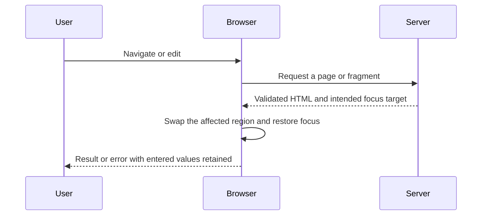

# Interface

## Purpose and design philosophy

The interface makes financial state legible and repeated work quick. It uses Sure's visual
language and page composition as inspiration, and Actual Budget's keyboard-first register
interaction. These are design influences, not requirements to reproduce another product.

The server owns financial validation. Browser controllers own focus, navigation, dialogs,
and charts. An interaction must not depend on a second financial model in JavaScript.

## Behavior

The desktop shell has an icon rail, a resizable and collapsible accounts panel, and the
active page. Navigation groups tracking, transaction work, and planning. Settings and
sign-out live in the user menu; configuration that is set up once and revisited, such as
categories and keywords, lives in Settings rather than on the rail. On small screens the rail becomes bottom navigation and
the accounts panel becomes a dismissible overlay; wide tables scroll inside their region. A page
built around long tables, such as the register or Categories, fills the window on large screens, so
each table scrolls under the controls above it while its header row stays in view; on small
screens the page scrolls as a whole. Menus open toward the side with room: those at the left of
the content extend right, so they never open under the accounts panel.

Shared components provide buttons, cards, dialogs, menus, tabs, tables, notices, and inputs.
Light, dark, and system themes use common semantic tokens. The theme is applied before
first paint and persists in browser storage. Financial amounts use aligned, tabular figures.

Privacy mode visually blurs marked amounts and charts and persists across page loads. It
is presentation, not access control: the page still contains financial data, and exports
remain readable. It does not replace signing out or protecting the local machine.

The wordmark cycles through omsync, ออมสิน, and om sĭn; the name evokes Thai saving money.
Geist and Noto Sans Thai support those forms. A pixel elephant provides the mascot and
favicon. Reduced-motion preferences stop the wordmark and mascot animation. Assistive
text announces the brand once rather than reading every animated variant.

## Interaction flow

Validation errors remain visible inside the relevant editor. Invalid input is not discarded
just because a server fragment replaces a row. Keyboard movement between register cells
stays local; editing and saving use server validation.

## Design rationale

Fragment replacement destroys the focused element. Focus restoration is therefore part
of the interaction contract, not optional polish. Swaps must also avoid replacing a search
field while the user types, or the caret and typed state are lost.

Table fragments and companion notices require careful response ordering because a browser
library may parse a fragment according to its first element. Keep implementation-specific
handling in code; preserve the reason for local rather than whole-page updates here.

A delegated register controller avoids repeated request attributes on every cell. This
keeps large registers lighter without introducing a client-side ledger or grid engine.

Browser storage can fail or be blocked. Presentation must fall back to usable defaults
rather than prevent access to the ledger. Source attribution for adapted components and
vendored assets stays with the code and license notices.
