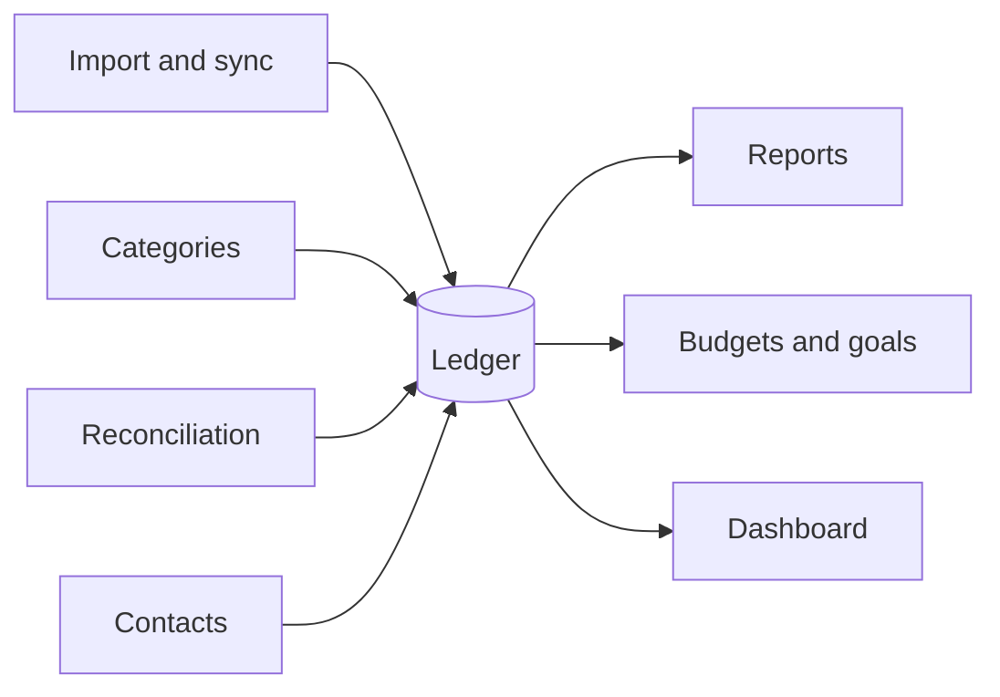
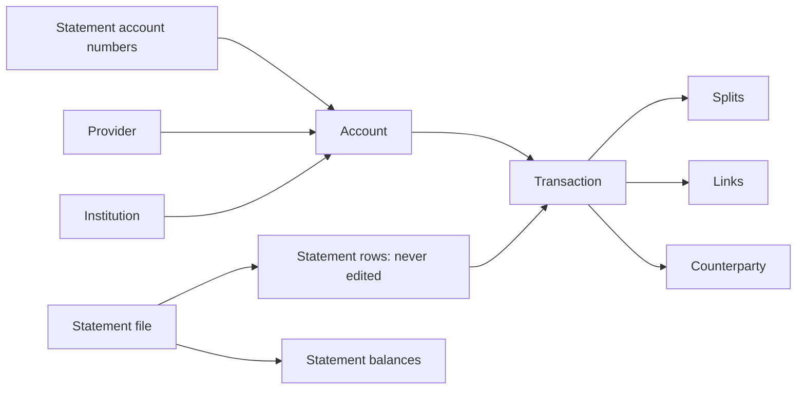
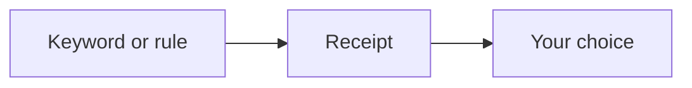

# Ledger

## Purpose

The ledger keeps what the bank reported apart from what you decide it means. The bank's evidence
never changes. Payees, categories, splits, counterparties, and links can change.

## Context

## Flow

### Data model

### Who sets a category

A stronger source can replace a weaker one. A weaker source never replaces a stronger one.

The counterparty works the same way: your choice outranks what omsync recognizes.

## Design decisions

- **A transaction keeps its ID for life.** Edits, receipts, and links survive new statement files.
- **Statement rows are never edited.** An edit to a payee or memo cannot change the basis of an
  earlier import.
- **An account is not its last four digits.** A reissued card gets a new number, not a new
  account.
- **Money is integer cents.** A negative amount is money out. A card purchase is negative.
- **Splits add up exactly to the transaction.** A report counts the splits or the transaction,
  never both.
- **Reconciled comes from links.** It is never a flag that you set.
- **Category, reconciled, and balance agreement are separate.** A categorized purchase is not
  always reconciled. A linked transfer does not prove that a statement history is complete.
- **Joint share is a report setting.** It never changes a transaction or a balance.

## Terms

- **Provider:** one bank login that fetches the accounts you pick. See [sync](sync.md).
- **Statement row:** one line of a statement file, as the bank wrote it.
- **Split:** a part of a transaction with its own category, memo, and counterparty.
- **Link:** a typed relationship that explains an amount: transfer, refund, P2P payment, joint
  settlement, or receipt.
- **Origin:** what set a category or counterparty: a keyword, a rule, a receipt, recognition, or
  you.
- **Category type:** fixed, flexible, non-monthly, unassigned, income, excluded, or owed.
  Excluded and owed money are not in reports.
