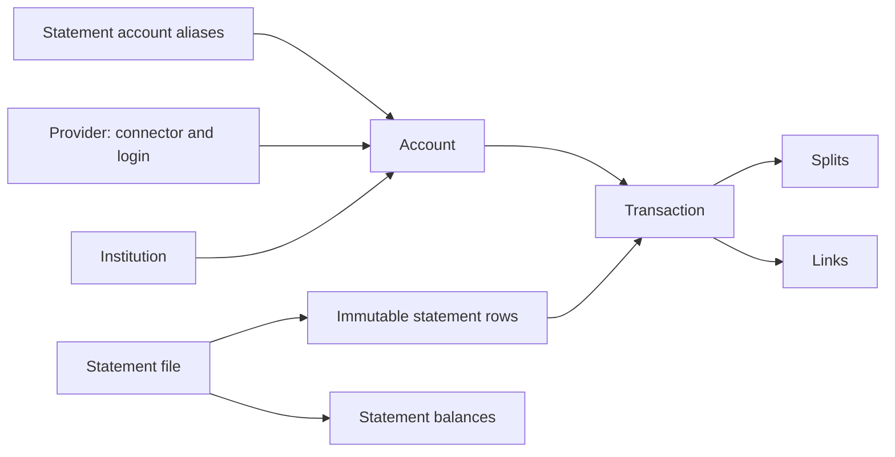

# Ledger

## Purpose and design philosophy

The ledger separates **what a source reported** from **what the user understands it to
mean**. Evidence remains intact while payees, categories, splits, and links can evolve.
A transaction is a real movement of money, not a line in a particular file.

## Identity and evidence

An **institution** holds financial accounts. An **account** has a permanent identity within
that institution and a **type**: checking, savings, credit card, brokerage, or other. Its last
four digits are a display label, not its identity. Statement account IDs map to accounts
through aliases: a reissued credit card can report a new ID without becoming a new account.

A **provider** fetches an institution's statements: a bank connector, the vault login it uses,
and the accounts it fetches. An institution may have several providers, each fetching only its
own accounts; an account has at most one. Providers are configuration, not evidence: deleting
one leaves its accounts, transactions, and statement files in place.

A **statement file** covers one account and a period. A **statement row** preserves the
file's reported fields and its position. Several rows from overlapping files can describe
one transaction. Source rows are not rewritten by edits to the ledger.

A **transaction** retains its identity for life. Its account, posted date, and signed amount
come from import. The **payee** shown to the user is set by import and categorization, and the
register does not edit it; source payee text is never changed. A new transaction's payee is
the statement row's description (see [import](import.md)), and its memo starts empty. A user
memo is separate from a statement's source MEMO, which is never copied into it.

## Money and classification

Money is integer cents throughout storage and financial calculations. A negative amount
is money out, including a credit-card purchase; a positive amount is money in, including a
card payment or refund. Display formatting never determines financial arithmetic.

A **split** assigns part of a transaction to its own category and memo. Splits conserve the
transaction's signed amount exactly. The parent is not counted again alongside its splits.
A transaction's amount cannot change merely because it is categorized or split.

A **category** describes what money was for, and its **type** says how the ledger treats it:
fixed, flexible, and non-monthly expenses are what a budget plans, unassigned is an expense not yet
classified, income contributes to income, and excluded money is left out of reports. Hiding a
category removes it from pickers without erasing history.

**Category origin** records who assigned a category. User choices outrank receipts, which
outrank keywords. Automation never replaces a user-assigned category or split. Origins are
part of the meaning of a classification, not just diagnostic metadata. Keyword precedence
belongs to [categories](categories.md); receipt protection belongs to [receipts](receipts.md).

## Relationships and balances

A **link** explains an amount with a typed relationship: transfer, refund, P2P payment,
joint settlement, or receipt match. Links explain money; they do not change the amount an
institution reported. A transaction is **reconciled** when its links cover its full absolute
amount. This is derived from links, never an independently editable flag. An
**acknowledgment** records that no counterpart is expected for a transaction; it explains no
amount and does not make the transaction reconciled (see [reconciliation](reconciliation.md)).

A **statement balance** is the institution's balance as of a date. Ledger balances and
available balances remain distinguishable. Account displays and goal progress use ledger
balances. The [account balance check](accounts.md) compares statements with transactions;
it does not invent a transaction to make a discrepancy disappear.

A **joint account** is shared with a partner. Joint share is a reporting choice, not a
mutation of its transactions or balances. The accounting treatment is owned by
[reports](reports.md) and shared by the dashboard and budgets.

## Design rationale

Permanent transaction IDs let edits, receipts, and links survive new statement files.
Aliases solve account identity without relying on labels that institutions may reuse or
change. Keeping evidence separate also prevents an edited payee or memo from rewriting the
basis of a previous import decision.

Classification, explanation, and balance agreement answer different questions. A
categorized purchase is not necessarily reconciled, and a fully linked transfer does not
prove that an account's statement history is complete. The product keeps those concepts
separate rather than collapsing them into one status.
