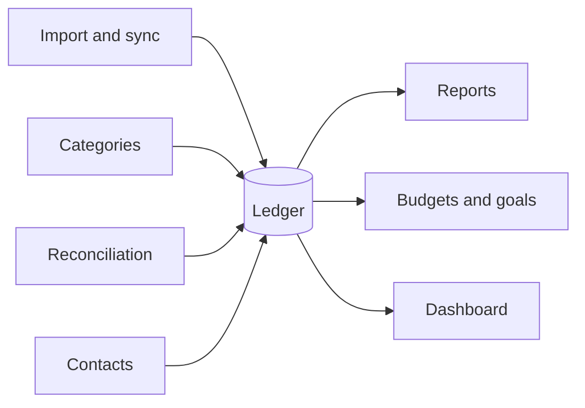
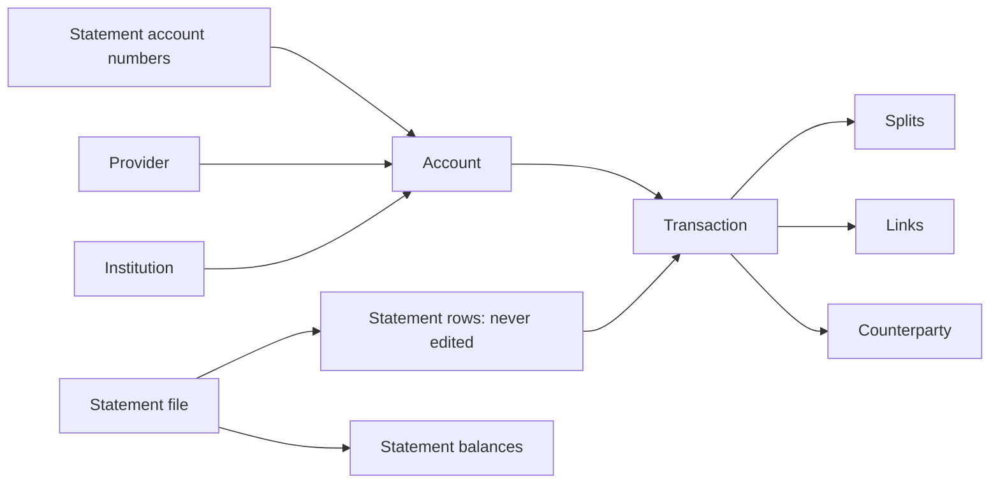
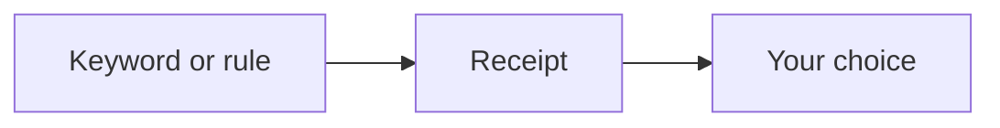

# Ledger

## Purpose

The ledger keeps what the bank reported apart from what you decide it means. The bank's evidence
never changes. Payees, categories, splits, counterparties, and links can change.

## Context

## Flow

### Data model

### Who sets a category

A stronger source can replace a weaker one. A weaker source never replaces a stronger one.

The counterparty works the same way: your choice outranks what omsync recognizes.

## Design decisions

- **A transaction keeps its ID.** Edits, receipts, and links stay attached when new statement files
  arrive.
- **omsync does not edit statement rows.** A later edit cannot change the basis of an earlier
  import.
- **An account is not a card number.** A new number for the same account is an alias, not a new
  account.
- **Reconciled status comes from links.** You cannot set it. A categorized transaction is not always
  reconciled.
- **Joint share is a report setting.** It does not change a transaction or a balance.

## Terms

- **Statement row:** one record in a statement file, as the bank wrote it.
- **Split:** a share of a transaction with its own category, memo, and counterparty.
- **Link:** a typed relationship that explains an amount: transfer, refund, P2P payment, joint
  settlement, or receipt.
- **Origin:** what set a category or counterparty: a keyword, a rule, a receipt, recognition, or
  you.
