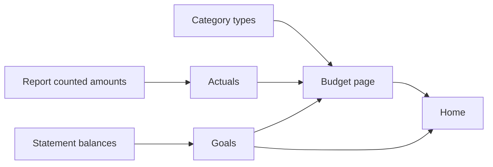
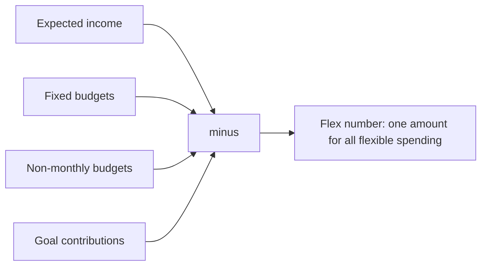
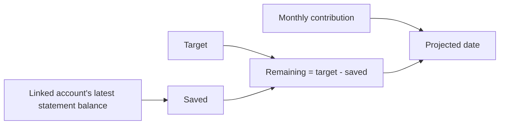

# Plan: budgets and goals

## Purpose

A budget plans this month's spending. A goal sets a savings or payoff target. Both use the ledger
for what really happened.

## Context

## Flow

### Flex number

Expected income is your override, or the average of the three complete months before.

### Goal progress

## Design decisions

- **Two modes, one set of data.** Flex budgets fixed and non-monthly costs. Everything else shares
  one number. Category mode budgets each category. A switch keeps both.
- **Actuals are report numbers.** Budget progress and reports agree for the same month.
- **Rollover stays with its category.** It never adds to the flex number. A reserve is not new
  money.
- **Non-monthly lines roll over by default.** Irregular costs need funds across months.
- **Expected income skips the current month.** A part month is not a full month of income.
- **Copy a month only into an empty month.** A copy never overwrites your work.
- **Goal progress is a reported balance.** A planned contribution is not savings until a
  statement shows it.
- **A goal does not reserve money.** Two goals on one account do not split it.
- **Flex comes from Monarch.** See [ADR 0001](../adr/0001-build-omsync-instead-of-using-sure.md).

## Terms

- **Budget mode:** flex or category.
- **Flex number:** the one amount for flexible spending.
- **Rollover:** unspent or overspent budget carried to later months.
- **Left:** budget plus carry minus actual spending.
