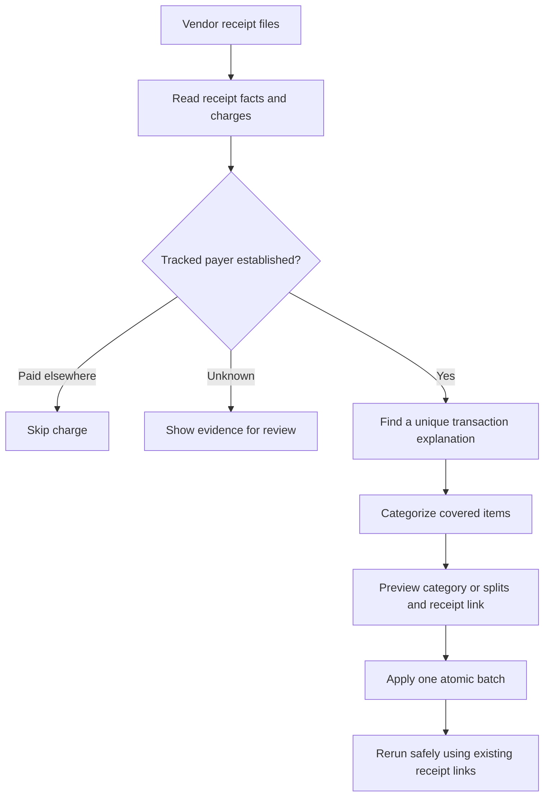

# Receipts

## Purpose and design philosophy

A receipt explains what a purchase or refund contained. It enriches an existing transaction;
it does not create money or replace a user decision. Receipt processing separates vendor
facts from the common work of categorizing, linking, allocating, and applying.

A **receipt vendor** is a merchant whose files omsync can read. A **vendor login** identifies
one sign-in's receipts. Every login is read, but only charges paid by a tracked account can
be applied. A **receipt item** is an itemized amount. A **charge** is the part of a receipt
paid as one transaction on one account. A **receipt match** links that charge to its transaction.

## Behavior

Vendors provide receipt facts, identify vendor payees, and describe charges. A charge can
be observed from the receipt or inferred from ledger evidence. If neither provides a safe
answer, the receipt stays for review. Failed parses also go to review with a safe reason.

A charge matches by amount, sign, vendor payee, payer account, and an appropriate posting
window. Date proximity can choose among otherwise fitting candidates, but a tie stays
ambiguous. Competing charges cannot silently claim the same transaction. An inferred charge
retains the transaction used to infer it instead of being searched again by amount.

A named card not tracked in omsync is paid elsewhere and can be skipped. A charge naming
no payer card is **unknown payer**: review can show possible transactions, but it is never
applied automatically. Amount and date alone cannot establish that a purchase from another
vendor login belongs to this user's ledger.

## Flow

Item categories use the vendor's [keyword list](categories.md). Missing categories go to
triage. A single category produces a transaction category; several produce splits. Tax
and discounts are allocated proportionally where appropriate, with cent-exact rounding.
Zero allocations do not create zero-value splits. Refunds retain their positive sign.

Applying a receipt never changes a user-assigned category or split. Receipt links retain
vendor, receipt identity, revision, login, and whether the charge was observed or inferred.
Undo restores the earlier classification and removes the receipt links according to the
[change contract](changes.md).

## Identity, scope, and reruns

A receipt revision represents its financial facts, including items, amounts, payment facts,
and refund state. A changed applied revision goes to review rather than silently applying
again. Ship dates are matching evidence, not financial facts: improved shipping evidence
must not invalidate an otherwise unchanged applied receipt.

Charge identities and transaction assignments must remain stable for the same evidence.
Whole-refund and split-refund charges use distinct identities. Inference includes a
receipt's own previously applied transactions, so a partial apply does not hide evidence
needed to finish the remaining charges. A changed assignment goes to review rather than
applying twice. A fully applied rerun changes nothing.

A selected period limits which matched transactions are planned and applied, not which
history is considered as evidence. Restricting the period must not turn an ambiguous match
into a unique one. Apply binds to the exact preview and its period, not just its count.

## Amazon rationale

Amazon orders and completed refunds are receipts, grouped within their vendor login.
Cancelled and zero-total orders contribute no charge. Amazon's per-item totals include tax
and shipping, so those totals must not receive tax a second time.

An order can be placed well before shipment and posting. Single-shipment matching uses the
ship date when supplied, with the order date also bounding the search; without shipping
evidence it uses the order date. Several shipments can produce several transactions. Only
an exact, unique transaction combination explains the order total; a greedy first-fit
choice could take an unrelated purchase. The search extends through the latest shipment
rather than stopping shortly after the original order date.

A refund first looks for one credit. Amazon can instead credit item groups separately, so
split credits are considered when no whole credit exists. Both the set of credits and their
assignment to refunded items must be unambiguous. Refund payer evidence comes from the
same login's order history; a refund without that order has an unknown payer.

Gift-card funding is not inferred from the order total. Amazon does not report the amount
paid by the gift card, so gift-only and mixed gift/card orders go to review rather than
inventing a card charge. Bounded inference also returns review when the search cannot safely
establish an answer; it never substitutes a guessed combination.

## Costco rationale

Costco receipts expose item amounts, tax, discounts, and card-payment amounts. An item-linked
discount or fee belongs with that item when their taxable treatment agrees. A return keeps
positive item, tax, and charge amounts. An unidentified credit line stays for review.

Each stated card payment is an observed charge. Cash, shop cards, and rebates do not create
tracked card transactions. Missing card amount or last-four evidence goes to review.
With several cards, each charge covers its proportional share of the receipt's categories;
the splits on each transaction must still sum exactly to that card's charge.

Costco receipt acquisition uses the user's manually authenticated browser session, not
vault credentials. Requests run inside that browser session, in three-month chunks.
Receipt barcodes identify files, repeated downloads skip existing receipts, and atomic file
replacement prevents interrupted writes from masquerading as completed receipts. Raw files
can contain membership information and remain private local data.

Obtaining and applying files is covered in [the operating guide](../how-to/sync-and-receipts.md).
